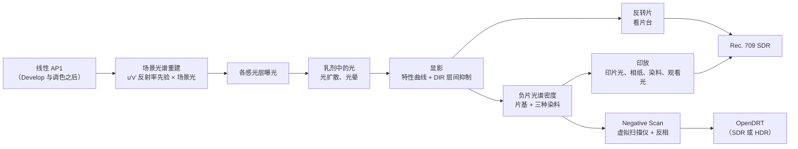
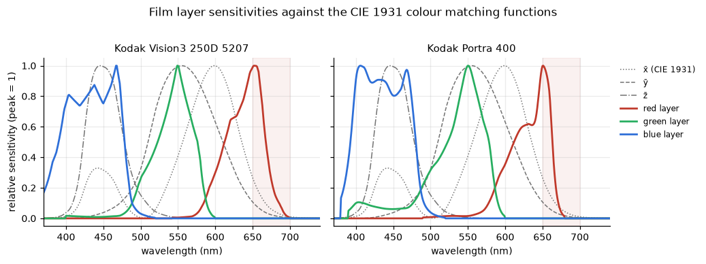
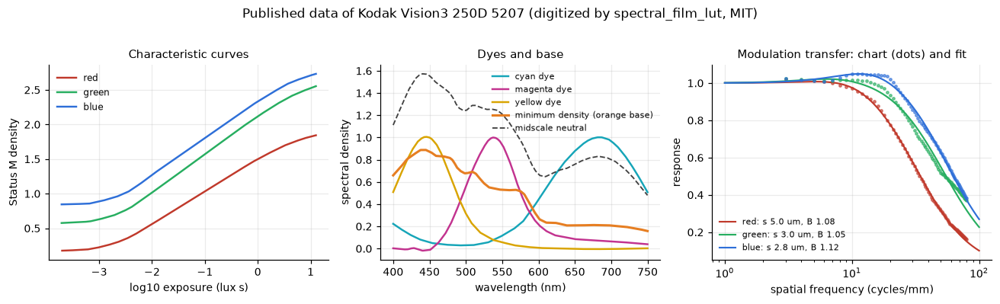
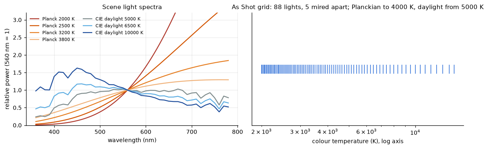
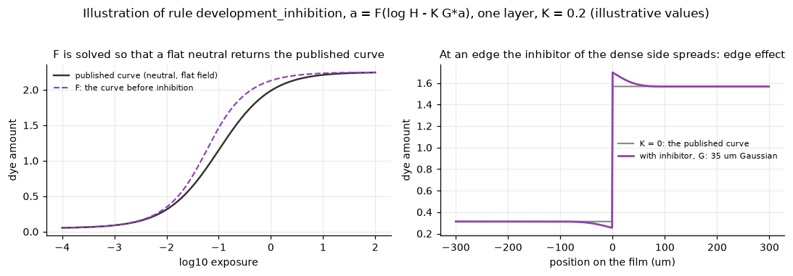
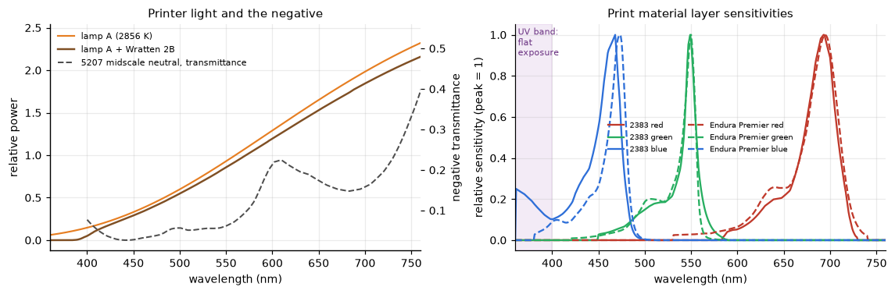
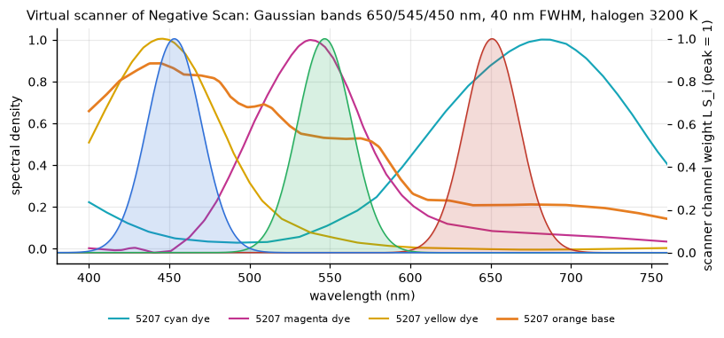
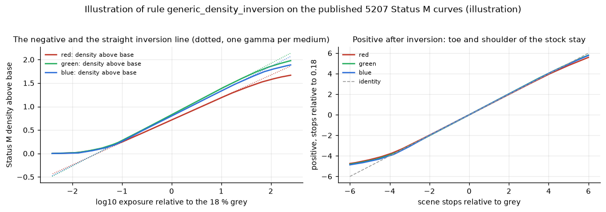

# 胶片模拟：原理、流程与 Alcedo Studio 的实现

> **文档性质：说明性文档。** 本文记录 Alcedo Studio 中光谱胶片模拟（Film Print DRT）的现状：它模拟的物理过程、每一步的理由、
> 数据的来源、在 GPU 上的实现，以及它和 spektrafilm 的对比。它是技术积累，供以后的开发者查阅。
> 计划、阶段记录和验收证据在 [Film Print DRT Plan](../film_print_drt_plan.md)；实验和测量在
> [alcedo-film-lab](https://github.com/zidage/alcedo-film-lab) 的 `docs/exploration/` 报告中。
>
> **对应版本。** 产品代码：分支 `feature/film-print-as-shot-and-recent-settings`，提交 `3b5b9ef43`（2026-11-05），
> 资源 schema 10，`kFilmPrintImplementationVersion` 13。实验室：alcedo-film-lab 提交 `8c3a4fe`。
> spektrafilm：上游 `main` 的 `3bb2c2d2`（2026-06-07，写作时的最新提交）。
>
> **阅读方法。** 正文中每个参数在第一次出现时先给出含义，再给出公式或数值。第 10 节的参数表汇总全部参数的含义、单位、取值和来源。
> 规则名（例如 `light_like_spectra`）是实验室报告和源代码注释中的名称，可以直接搜索。

---

## 目录

1. [一页总览](#1-一页总览)
2. [光谱模拟的理由](#2-光谱模拟的理由)
3. [数据来源](#3-数据来源)
4. [主流程](#4-主流程)
5. [从光谱模型到 GPU](#5-从光谱模型到-gpu)
6. [产品界面与文档数据](#6-产品界面与文档数据)
7. [验证方法](#7-验证方法)
8. [开放问题](#8-开放问题)
9. [与 spektrafilm 的对比](#9-与-spektrafilm-的对比)
10. [参数表](#10-参数表)
11. [术语表](#11-术语表)
12. [参考资料](#12-参考资料)

---

## 1. 一页总览

Film Print 是显示变换（DRT）面板中的一个方法，和 ACES 2.0、OpenDRT 并列。它把场景线性的 AP1 图像当作照到胶片上的光，依次计算：




*来自实验室 README：1. 产品曝光后的输入；2. 模拟的 5207 负片，带橙色片基；3a. 印放到模拟的 2383；3b. 当时的 APD 扫描（ADX10 + ACES 2.0，
后来由 Negative Scan 取代）。图像展示 2026-10-31 的 Python 原型的外观；之后 issue #645 修改了印放条件。照片出处见实验室
`docs/images/CREDITS.md`。*

关键事实：

| 项目 | 现状 |
| --- | --- |
| 方法 | 物理的、光谱的过程：场景光谱、每层曝光、显影、印放或扫描。每个阶段对应一个可检查的物理量；片种的偏色和性格全部来自片种数据。 |
| 片种 | 30 种彩色负片；5 种彩色反转片（Velvia 50、Velvia 100、Provia 100F、Astia 100F、Ektachrome E100）。 |
| 输出材料 | 18 种相纸和电影拷贝片（来自数据），1 个创意材料 Cine Look (2383)，以及 Negative Scan。 |
| 场景光 | As Shot（默认，取 RAW 白平衡的色温和色调）、参考光，以及日光、钨丝灯、荧光灯、LED、钠灯等光源和混合场景。 |
| 后端 | CUDA、OpenCL、Metal，三者共用一份点运算数学头文件 `film_print_math.h`。渲染全部在 GPU 上。 |
| 速度 | 24 MP（6000 x 4006），改动一个滑块后：CUDA 约 21 ms（RTX 3080 Laptop），Apple M4 约 63 到 68 ms。换片种约 0.8 s（建表加上传）。 |
| 数据规模 | 安装包中约 28 MB 资源（片种数据 2.7 MB、印放设置 167 KB、压缩的反射率表 25 MB）。查找表在运行时于内存中构建。 |

---

## 2. 光谱模拟的理由

### 2.1 胶片和人眼对颜色的响应各自独立

数码相机和人眼可以用三个数（RGB 或 XYZ）描述颜色。胶片的三个感光层各有一条**光谱灵敏度曲线**（每个波长的光让这一层感光的程度），
这三条曲线和人眼的**颜色匹配函数**（CIE 1931 标准观察者对每个波长的三个响应）是两组曲线。下图把两种胶片的三层灵敏度画在颜色匹配函数旁边：



*5207 和 Portra 400 的红感层峰值在约 650 nm，并延伸到约 690 nm（浅红色区域），这里人眼的权重已经很小。蓝感层延伸到 400 nm 以下。
数据：spectral_film_lut 数字化的 Kodak 数据手册。*

结果是：两个对人眼颜色相同、光谱各异的光（**同色异谱**，metamer），在胶片上可以得到各异的曝光。实验室 P1 的测量：同一个灰色的 XYZ
可以对应红感层密度 0.39 到 1.21 之间的任意值；实测的同色异谱样本之间相差可达 0.06 密度。胶片的响应由光谱决定，所以模拟的第一步是为每个像素
选一条合理的光谱。

### 2.2 设计原则

这些原则来自实验室 ROADMAP 第 2 节的用户决策，也是产品代码遵守的规则：

1. **物理过程，分阶段。** 场景光谱、层曝光、显影、负片、印放或扫描、观看，每个阶段输出一个可单独检查的量。曝光、染料量、仪器密度、
   光谱密度、编码 RGB 各是一种量，各自保持自己的单位。
2. **保留片种的性格。** 胶片阶段只包含光谱计算。每种胶片的偏色、交叉（crossover，三个通道的曲线在亮部和暗部偏离的方式）和反差全部来自它的数据。
3. **以眼睛为准。** 最终由渲染图像在一组带标签的照片（人像、白天、夜景）上判断。
4. **每个数值有出处。** 数值来自公开数据（数据手册、标准），或明确标为推断值或创意选择。
5. **失败时报告真实错误。** 资源损坏、GPU 分配失败等情况停止渲染，并给出带文件名或原因的错误。

---

## 3. 数据来源

### 3.1 一份胶片数据手册的内容

厂商数据手册通常有四类图。以 Kodak Vision3 250D 5207 为例：



| 图 | 含义 | 在模型中的用途 |
| --- | --- | --- |
| 特性曲线（左） | 中性灰在各曝光量（log10 lux s）下的 Status M 密度。Status M 是负片用的标准密度计响应。曲线分趾部（toe，暗部的弯曲）、直线部和肩部（shoulder，亮部的弯曲）。 | 显影曲线：从层曝光到染料量 |
| 光谱灵敏度（见 2.1 节的图） | 每层对各波长的灵敏度，以 log10 表示 | 层曝光的积分权重 |
| 光谱染料密度（中） | 青、品、黄三种染料对各波长的吸收；最小密度 D_min（未曝光部分的密度，即橙色片基与色罩）；中等中性灰 | 负片的光谱密度 |
| 调制传递函数 MTF（右） | 各空间频率（每毫米周期数）的对比传递比例。高于 1 的部分来自显影的边缘效应 | 光扩散长度和层间抑制强度 |

### 3.2 来源

| 来源 | 内容 | 许可 |
| --- | --- | --- |
| [spectral_film_lut](https://github.com/JanLohse/spectral_film_lut) `bcbcfc68` | 约 60 种负片、相纸和反转片的手工数字化数据；Status A、Status M 和 APD 表 | MIT，可直接采用 |
| Kodak 数据手册的矢量图（实验室自行数字化） | Portra 400 + Endura Premier（P0），E100 和 Velvia 100（P9）。PDF 中的曲线是矢量路径，可以直接提取（刻度残差最大 0.0007 密度、0.09 nm） | 数值可以发布；PDF 原件保留在本地 |
| [Fotufilm](https://github.com/DhaliwalX/fotufilm-engine) | Astia 100F 的曲线（CC BY-SA 4.0）；测量反射率先验的思路 | Apache-2.0（代码） |
| CIE 和标准 | CIE 1931 观察者、标准光源 A、日光分量、荧光灯；ISO 3664 观看条件；SMPTE 196M 放映白点 | 公开 |
| ISSA 等反射率数据集 | 反射率先验的训练数据 | CC BY 4.0 等，发布前需记录 |

### 3.3 需要推断的字段

公开数据给出的是一种胶片的部分信息。实验室把下列字段标为推断：

- **染料曲线。** 照相负片的数据手册给出中性灰和 D_min。这些片种的三种染料由**波段拆分**得到：把一条中性光谱按波长拆成三个染料波段。
  5207 和 5219 有单独的染料曲线，它们相加与中性灰的误差 RMS 为 0.003 和 0.005 密度，因此被读作已扣除色罩的净曲线。
- **700 nm 以上的负片密度**由外推得到。相纸红感层约 26 % 的印放权重位于这个区域。
- **层间抑制在各层之间的分配**取 0.5（推断）。
- **相对灵敏度。** 13 个片种的灰点落在曲线趾部，图表只给出相对水平。它们使用规则 `grey_anchor`：平衡光（片种设计使用的光，D55 日光或
  T3200 钨丝灯）下的 18 % 灰直接对准曲线的标准点。增益只作用在平衡光的灰点上，所以片种的交叉保留。

---

## 4. 主流程

本节按光的路径讲解每一步。每一步分三部分：**科普**（这一步在真实胶片中发生什么），**模型**（实验室选择的公式和规则，以及理由），
**产品**（代码位置和实现方式）。

产品中的编号 FP1 到 FP6 是 Film Print 的 GPU 步骤：

| 步骤 | 内容 | 类型 |
| --- | --- | --- |
| FP1 | 入口色域压缩，AP1 到 XYZ，`spectral_locus_projection`，读 u'v' 曝光表，层增益，得到每层曝光 Q | 点运算 |
| FP2 | 光扩散：两遍，每遍每层一个高斯 | 模糊 |
| FP3 | 光晕：读规范画布，按层混合 | 画布 + 点运算 |
| FP4 | 由曲线得到初始染料量；抑制的逐点部分；抑制剂的高斯模糊（sigma 达到 4 像素时在半尺寸图像上） | 点运算 + 模糊 |
| FP5 | 两步不动点迭代 | 点运算 + 模糊 |
| FP6 | 放大机眩光、密度、印放表、立方、显示矩阵、色域压缩、显示编码（反转片和 Negative Scan 有各自的形式） | 融合的点运算 |

### 4.0 输入

**产品。** 输入是 `DiffusionFilter` 通道输出的线性 AP1：整个 Develop 和调色链之后的图像，和其他 DRT 方法相同。`graph_compiler.cpp` 的
`CompileDrt` 先推入 `DiffusionFilter`（它把 ACEScc 解码为线性 AP1），再推入 `Drt`；Film Print 是 `Drt` 通道的 `DisplayTransform` 步骤。

- **产品默认调色。** RAW 文档的默认调色是曝光 +1.5 EV、对比度 15、饱和度 1.3，位于胶片之前。从其他方法切换到 Film Print 时，如果饱和度
  仍是导入时的默认值，同一个历史批次把它写成 1.0（实验室 U80），一次撤销同时恢复两者。
- **入口色域压缩。** 印放和反转片形式在入口使用 ACES Reference Gamut Compression（RGC，把 AP1 之外的颜色压回色域边界，规则
  `entry_reference_gamut_compression`），与其他 DRT 方法相同。Negative Scan 的入口直接进入 FP1，它的输出之后交给 OpenDRT。
- **后续步骤。** Clarity、Sharpen、Film Grain 在 Film Print 之后运行。选中 Film Print 时，调度跳过原有的 Halation 算子
  （`drt_post_schedule.cpp`），光晕由胶片模型按感光层计算。

### 4.1 场景光谱重建

**科普。** 每个像素有三个数，照到胶片上的光却是一条光谱。三个数对应无穷多条光谱，所以只能选择一条合理的光谱。合理的标准来自统计：
真实物体的反射率通常平滑、非负，并有一些典型形状。

**模型。** 先定义以下量：

- `Y`：像素的亮度（CIE XYZ 的 Y）。
- `(u', v')`：CIE 1976 色度坐标，只描述颜色的色相与饱和度。
- `ρ(u', v', λ)`：色度为 (u', v') 的物体的反射率光谱，λ 为波长。
- `L(λ)`：场景光的光谱。
- `E(λ)`：到达胶片的光谱。

到达胶片的光谱写成：

```text
E(λ) = Y × ρ(u', v', λ) × L(λ)
```

1. **亮度和颜色分离。** E 正比于 Y，所以曝光对亮度是线性的：多一档曝光，每层曝光正好翻倍（实验室检查：误差 7e-14）。高光可以是任意亮度。
2. **反射率先验表。** 在 u'v' 平面上建一个 192 x 192 的节点网格，每个节点保存一条平滑、非负的反射率光谱（360 到 840 nm，1 nm 步长）。
   光谱来自测量反射率数据集的局部先验（P1 选择的非负局部先验）。
3. **规则 `light_like_spectra`（P4）。** 反射率先验对天空有系统偏差：很多蓝色物体在远红区再次反射，天空光在远红区很弱。在天空的颜色上，
   先验在 700 nm 处给出 1.68，真实天空为 0.38。结果 5207 的红感层多出 +0.164 log10 的曝光，天空偏紫。规则在白点附近的两个扇区（天空方向和
   2500 K 低色温方向）把光谱换成平滑的光源形光谱 `exp(c0 + c1 x + c2 x²)`（c0、c1、c2 是拟合系数，x 是归一化波长），并保持节点的 XYZ。
   天空误差降到 -0.011。代价：蓝色花朵等物体的远红反射随之消失。照片中光和物体混合在同一个像素值里，而天空和日落在风景中面积更大，
   所以选择偏向光源。
4. **规则 `foliage_spectra`（P6，U73）。** 在绿色扇区把形状换成叶片形（叶绿素吸收带、绿峰、红边），保持 XYZ。依据：Noritsu 扫描的真实
   Portra 160 中叶子呈干净的绿色，模型把叶子印得偏黄；合成的叶片光谱让红感层曝光比原表低 0.098 log10。规则写在表中，所以每个片种用自己的
   灵敏度去响应它。
5. **规则 `spectral_locus_projection`（P1，U14）。** Y ≤ 0 时曝光为 0。色度位于可到达区域之外时，在亮度保持的条件下沿白点方向拉回到边界。
   规则连续，只依赖色度。


*图来自实验室 README：一种合成天空颜色上，反射率先验（远红过多）与 `light_like_spectra`（贴近天空形状）的对比。这是平滑光谱族上的自洽演示。*

**场景光。** 场景光 L(λ) 乘在反射率形状上。它的作用超出白平衡：在夜景或钨丝灯下，每层落在各自曲线的不同位置，和真实胶片相同。



- **As Shot（默认，issue #672；色调规则见 Film Grain 计划 G8）。** 取 RAW 解码的白点：Develop 的 Custom 模式取用户输入的开尔文值和色调（tint），
  其他模式取求解出的拍摄色温和色调。色温选出网格光：色温网格以 **mired**（10^6 / 色温）为单位，因为 mired 的等间距更接近视觉上的等间距。资源中有
  88 个网格光：从 500 到 70 mired 每 5 mired 一个，加上 15000 K；4000 K 及以下是普朗克光源（黑体），5000 K 及以上是 CIE 日光，中间按 mired
  线性混合。主机按 mired 线性混合相邻两个网格光（`FilmStockBundle::GridLight`），混合作用于光谱、层增益、印片平衡等所有依赖光的值。网格步长使
  混合结果与精确光源之差在 0.5 个 8 bit 码值以内。栅格输入或颜色变换求解失败时，As Shot 按参考光渲染，面板隐藏该选项。
- **色调（规则 `as_shot_tint`）。** 定义 **Duv** 为 CIE 1960 uv 中光源到普朗克轨迹的有符号距离，偏绿为正（Develop 的色调 / 3000）。荧光灯、
  汞灯、钠灯、LED 和绿荫下的光位于轨迹上方：`sample_images/raw/` 的 10 张夜景中有 5 张的 Duv 为 +0.011 到 +0.017，日光照片为 +0.003 到 +0.006
  （CIE 日光为 +0.0034）。主机把网格光沿轨迹法线移动"RAW 白点的 Duv 减去网格光的 Duv"作为目标色度，然后给网格光乘两个因子，并对每种胶片
  求解两个增益，使光源到达目标色度（`FilmStockBundle::ResolveLight`）：
  - 色调因子 `10^(k g(λ))`：`g` 是中心 550 nm、标准差 50 nm 的高斯（汞和铽荧光粉的绿线在 545 到 546 nm），`k` 是增益。
  - 维恩因子 `exp(-C2 dm 10^-6 / λ)`：`C2` 是普朗克定律的第二辐射常数，`dm` 是 mired 变化量。在维恩近似下该因子把光源移动 `dm` mired。
    色调因子本身会让暖光沿轨迹移动最多 180 mired，维恩因子把这部分移回，使光源保持网格光的色温。维恩因子与网格无关，因此网格两端
    （2000 K、15000 K）的 RAW 白点同样得到色调。

  光源保持亮度 Y。RAW 白点的 Duv 等于网格光的 Duv 时，光源就是网格光。`|k|` 的上限是 1（550 nm 处 10 倍）：Develop 范围（2000 到 15000 K，
  Duv -0.05 到 +0.05）中，位于光谱轨迹以内的色度最多需要 `|k|` = 0.78；2000 K 的 Duv +0.02、+0.05 和 3200 K 的 Duv +0.05 位于光谱轨迹以外，
  超出真实光源的色度范围。到达上限时，光源保持网格光的色温，沿法线向 RAW 白点移动到上限允许的位置（2000 K 移动 0.0095，3200 K 移动 0.031）。
  负片扫描和看片台使用带色调的光源；印放的印片光跟随该光源下 18 % 灰在负片上的记录（印片平衡减去该灰的相纸 log10 曝光的变化），负片调色规则的
  灰记录同样移动。
- **参考光（reference）。** 场景光取平衡光，片种呈现设计条件下的颜色。
- **As Shot 作为默认的理由。** 胶片记录拍摄现场的光。As Shot 让 RAW 白平衡的偏色进入负片：钨丝灯片（5219）在日光下偏蓝，日光片在钨丝灯下偏暖；
  偏绿的光源让偏色带绿：日光片在偏绿的夜景光下偏黄绿，5219 在偏绿的日光下偏青蓝。印放的印片平衡或扫描的自动颜色再决定保留多少偏色。

**产品。**

- 反射率表以压缩形式随安装包发布（规则 `compact_reflectance_table`）：保留用到的 346 个波长（360 到 705 nm）、读取能到达的 18103 个 u'v' 节点、
  12 位尾数，每个 float32 字节单独成一个字节平面（便于 xz 压缩）。71 MB 的完整表变成 25 MB（xz 后 5.6 MB）；u'v' 相对差最大 1.2e-4，
  最终 sRGB 差最大 0.0054 个 8 bit 码值。
- 选定片种和场景光后，主机在每个节点上对"反射率 × 场景光 × 层灵敏度"积分，得到 192² x 3 的 **u'v' 曝光表**（`BuildUvTable`，约 3 ms）。
  GPU 上每个像素只做一次双线性读取。
- FP1（`FilmKernelLayerExposure`）：AP1 到 XYZ；Y ≤ 0 时曝光为 0；`spectral_locus_projection` 先用内切圆做快速判断（`_DSC8148` 上 95.5 % 的像素
  在圆内，直接跳过 41 个边界面的循环）；然后计算 u'v'，双线性读表，乘以亮度和层增益得到每层曝光 Q。

### 4.2 各感光层的曝光

**科普。** 每个感光层对到达的光谱做加权积分，得到这一层接收的光量。

**模型。** 定义 `S_i(λ)` 为第 i 层（红感、绿感、蓝感）的光谱灵敏度，`H_i` 为第 i 层的曝光量：

```text
H_i = ∫ E(λ) S_i(λ) dλ
```

- **灰点曝光。** 新片种的 18 % 灰曝光取 `12.5 / ISO` lux s（ISO 为片种的感光度；规则 `stock_options_from_catalog`）。
- **层增益。** 层增益是每层一个乘数，它把平衡光下的 18 % 灰放到该层曲线的标准点上（相对灵敏度的片种用 `grey_anchor`，见 3.3 节）。
- **单位。** 灵敏度使用辐射能量单位，积分直接使用它们。

**产品。** 层增益来自 `film_print_setup.bin`，每个"负片 x 场景光"一组，已折进 FP1。FP1 的输出写作 `Q_k = 层增益_k × Y × 表_k(u', v')`，
Q_k 是第 k 层的相对曝光。

### 4.3 乳剂中的光：光扩散与光晕

**科普。** 光进入乳剂后被银盐颗粒散射，胶片上的一个点扩成一个小光斑，这决定了胶片的锐度。一部分光穿过乳剂和片基，在片基背面反射回来再次曝光，
主要到达最下面的红感层：这就是强光周围的红色光晕（halation）。

**模型。**

- **光扩散（`layer_spread`）。** 每层一个指数型扩散。先定义 MTF 拟合中的参数：
  - `f`：空间频率，单位为每毫米周期数。
  - `s`：光扩散长度，光在乳剂中扩散的特征距离。
  - `B`：边缘效应带来的高频提升量（B = 1 时 M 只含扩散项）。
  - `σ_d`：抑制剂扩散的高斯长度。
  - `M(f)`：频率 f 上的对比传递比例。

  实验室的 MTF 形式（P4）：

  ```text
  M(f) = 1 / (1 + (2π s f)²) × B / (1 + (B - 1) exp(-2π² σ_d² f²))
  ```

  第一项是扩散长度为 s 的指数扩散，第二项是显影边缘效应的高频提升。5207 的拟合：s 为 4.95、3.02、2.83 µm（红、绿、蓝）。指数核用两个高斯之和近似
  （传递函数最大误差 0.028）。实验室比较过单个高斯，它让灯光边缘变硬，最大差 83 个码值，所以保留两个高斯。
- **光晕。** 一个标准差 120 µm 的高斯，强度按层为 0.03、0.008、0（红层最强）。这两个值是推断值。
- **尺寸换算。** 空间尺寸以胶片上的微米计。画幅长边取 36 mm（所有片种共用这个假设），所以长边 6000 像素时每像素 6 µm。

**产品。**

- FP2：两遍可分离模糊，每遍每层一个高斯。高斯的 sigma（像素）= 近似比例 × s × 滑块 / 每像素微米数，再乘 `RenderAxisScale`（预览图相对全尺寸的缩放）。
  窄高斯的半径在 2 像素以内时并入垂直遍。边界规则为反射（reflect）。
- FP3：光晕在 6000 像素时 sigma 约 20 像素，超过邻域算子 64 个采样点的上限，所以在 2048 像素的规范画布上计算并发布为 `film.halation.0`
  （画布上 sigma 约 6.8 texel）。混合为 `(1 - h) Q + h × blur(Q)`，h 为该层的光晕强度（常数 × 滑块）。缩放和平移读取已发布的结果，效果保持一致。
- FP2 在渲染像素上运行，所以"适应窗口"预览中的光扩散比 100 % 时小，和真实胶片相同。

### 4.4 显影与层间抑制（DIR）

**科普。** 显影时，曝光多的地方析出的银多，生成的染料也多。现代彩色负片含 DIR 成色剂（Development Inhibitor Releasing coupler）：它在显影处释放
抑制剂，抑制剂扩散开，减慢本层和相邻层的显影。两个效果：

- **边缘效应**：在明暗交界处，亮侧的抑制剂扩散到暗侧，把暗侧压得更暗；亮侧边缘的抑制剂流走，显影更多。交界因此看起来更锐，这也是 MTF 曲线高于 1 的原因。
- **层间效应（interimage effect）**：一种颜色只让一两层显影，这些层抑制其余层，于是颜色分离更大、饱和度更高。中性灰三层都显影，它们相互的抑制已经包含在
  已发表的灰阶曲线中。

**模型。**

1. **染料量曲线（`dye_amount_curves`）。** 已发表的特性曲线是仪器（Status M）读出的中性灰密度，包含三种染料的共同吸收。实验室在中性灰阶上解一次染料量，
   得到从 log 曝光到"该层染料量"的曲线。之后每个颜色都带着各自染料的副吸收（一种染料在其他波段的吸收）。
2. **抑制（`development_inhibition`）。** 先定义：
   - `a_i`：第 i 层的染料量。
   - `K_ij`：第 j 层的染料量对第 i 层曝光的抑制强度（单位：每单位染料量减少的 log10 曝光）。
   - `G`：抑制剂在胶片平面上的扩散核，一个 35 µm 的高斯；`G * a_j` 表示 a_j 被它模糊后的值。
   - `F_i`：第 i 层"抑制之前"的曲线。

   ```text
   a_i = F_i( log H_i - Σ_j K_ij (G * a_j) )
   ```

   **关键：F_i 由反解得到**，条件是一个大面积的中性灰（此时 `G * a = a`）正好返回已发表的曲线。于是中性灰和大面积色块保持已发表的影调；颜色得到更多分离
   （各层之间的抑制少于灰色中的抑制）；交界处得到边缘效应。
3. **K 的来源。** 每层的总 K 由 MTF 的高频提升 B 拟合得到（5207：0.145、0.079、0.204）；K 在本层与其他层之间的分配取 0.5（推断）。规则
   `inhibition_image_part`（#642）把 K 分为两部分：**图像部分** K_image（由 35 µm 拟合得到，经过模糊）和**逐点部分** K_point = K - K_image（直接作用于本像素）。
   规则 `inhibition_total_from_image_part`（U80）之后，总 K 等于图像部分。
4. **两步不动点（`inhibition_two_steps`）。** 公式两边都有 a，所以用迭代求解：从初始值出发反复代入。实验室 P6 用 4 步；产品为了速度用 2 步。30 种负片中
   24 种与 4 步之差在限制以内（均值 0.5、p99.9 2.0、最大 5.0 码值）；5277、Eterna 500 与 Vivid、5203、Aerocolor、Ektar 100 这 6 种强抑制片种超出限制，
   用户在实验室看图后接受了它们的结果（U72）。



*示意，数值为说明用：左图，F 是抑制之前的曲线，反解使平坦的中性灰正好落在已发表曲线上；右图，在一个曝光台阶处，K = 0.2 时交界出现边缘效应，平坦区域与
K = 0 时相同。*

> **与 spektrafilm 的关系。** 第一步不动点与 spektrafilm `model/couplers.py` 的算法相同（先补偿曲线，再施加抑制）。实验室早期研究读过该方法。
> K 的数值来自本项目对 MTF 图的拟合。见第 9 节。

**产品。**

- FP4：先由曲线得到 `a0 = 曲线(log Q)`，再算 `a1 = F(log Q - K a0)`，然后保存 `log Q' = log Q - K_point a1`。之后每一步只做 `a = F(log Q' - K_image I)`，
  I 是模糊后的染料量。只有逐点部分的负片在一次调度中完成全部计算。
- 抑制剂的 sigma 在 6000 像素时约 5.8 像素。sigma 达到 4 像素时，模糊在半尺寸图像上进行（`inhibitor_on_half_size`），并扣除缩小带来的方差。
  奇数尺寸时最后一个半尺寸单元含 3 个像素，与实验室在奇数尺寸时的分格有差异（issue #639）。
- 6000 像素时两步加模糊约 4.6 ms（CUDA）。

### 4.5 负片的光谱密度

**科普。** 冲洗后的负片是三层染料叠在橙色片基上。橙色来自片基和**色罩**：色罩是带颜色的成色剂，用于补偿青、品染料的副吸收。负片因此呈现为橙色的反色图像。

**模型。** 定义 `ε_k(λ)` 为第 k 种染料单位染料量的光谱密度，`D(λ)` 为负片在波长 λ 的总密度，`T(λ)` 为透射率（透过光的比例）：

```text
D(λ) = D_min(λ) + Σ_k a_k ε_k(λ)
T(λ) = 10^(-D(λ))
```

片基只计入一次。这个光谱密度是印放和扫描的共同起点。

**产品。** GPU 上每个像素保存三个染料量 a_k，称为**记录**（record）。所有从记录到下一阶段的光谱积分都预先算进 65³ 的表（第 5 节）。

### 4.6 输出 A：印放（Print）

**科普。** 传统暗房：放大机的光（钨丝灯，加滤镜调色）穿过负片，照到相纸（或电影拷贝片）上。相纸本身也是负性材料，两次反相得到正像。冲洗后的相纸在观看光下被人眼看到。
电影拷贝片（2383）在黑暗的影院里用氙灯放映。

**模型**（实验室 P2 到 P7，以及 issue #645 的"印放条件来自来源"，U78）：

1. **放大机眩光（Enlarger flare）。** 镜头杂散光把一部分平均光均匀地洒在相纸上，使负片的浓密区发灰。定义 `f` 为杂散光份额，`blur` 为透射率经大模糊
   （sigma 为长边的 10 %）后的值：`a' = -log10((1 - f) 10^-a + f × blur)`。f 的默认值为 0.01（推断）。
2. **印片光。** 光源 A（CIE 标准白炽灯，2856 K）。电影拷贝片加 Wratten 2B 紫外滤镜（规则 `printer_uv_filter`）。

   

   *左：光源 A、加 2B 滤镜后的光源 A，以及 5207 中等灰的透射率。右：2383（实线）与 Endura Premier（虚线）的感光层灵敏度。2383 的蓝感层在
   400 nm 以下仍然敏感（紫色区域），而负片黄染料的吸收在 450 nm 以下减弱。*

   这是 issue #645 的发现：只用光源 A 时，5207 灰透过后照到 2383 蓝感层的曝光有 25 % 位于 400 nm 以下，这部分曝光在各像素上几乎相同，于是 2383 拷贝整体偏黄绿。
   2383 和 2393 的数据手册写明总滤光应包括紫外吸收滤镜，例如 KODAK WRATTEN 2B。反射相纸上这个比例约为 3 %，所以 Endura 上的影响很小。
3. **印片平衡（printer balance，也叫定时 timing）。** 印片光的三色强度。对每个"负片 x 相纸 x 场景光"计算一组印片光，使平衡光下 18 % 灰的每个通道落在
   相纸的**目标灰**（aim）：反射相纸为 Status A 密度 0.75（即 18 % 反射率；Status A 是正片和相纸用的标准密度计响应）；电影拷贝片为 LAD 灰块的
   1.09、1.06、1.03（LAD 是电影洗印厂的目标灰密度，来自 KODAK H-61b）。场景光与平衡光相异时，偏色留在负片上，印片光只校正平衡光，所以夜景保留夜景的颜色。
4. **相纸曝光与曲线。** 先定义：`aim` 为目标灰对应的相纸 log 曝光；`contrast` 为印放反差系数（取 1，即已发表的相纸曲线）；`gain` 为印片增益。

   ```text
   log H' = aim + contrast × gain × (log H - aim)
   ```

   电影拷贝片的 gain 来自规则 `print_slope_match`（强度 0.5，让各负片在拷贝片上的灰阶斜率向一致靠拢；这是产品的选择）。相纸曲线给出 Status A 密度，
   再解相纸的染料量得到它的光谱密度。
5. **观看。** 观看光穿过（或反射自）相纸染料，积分到 XYZ。
   - 反射相纸：观看光 D50（印刷与看样的标准日光），显示白取完美反射体，所以相纸白略低于显示白。
   - 电影拷贝片：观看光 D54（SMPTE 196M-2003 的 5400 K 放映白；用 D54 代表氙灯光谱是推断），显示白取透明拷贝（`clear_print_white`）。
     暗环境下人眼对亮度的感受被压缩，用**环境指数** e 表示：亮度 Y 变为 Y^e，e = 0.525 / 0.59 = 0.89（`dark_surround_on_display`，来自 CIECAM02 的暗环境与
     昏暗环境参数）。
6. **显示。** XYZ 到线性 Rec. 709，然后做规则 `rgc_style_display_compression`：最大通道保持，其余通道到最大通道的距离用幂函数压缩（形式类似 ACES RGC，
   作用在 Rec. 709 上，参数为阈值、尺度和幂），然后裁剪到 0 到 1，再做 sRGB 或 gamma 编码。输出为 Rec. 709 SDR。

**印放表的分段构建（`staged_print_table`，P7）。** 步骤 2 到 6 只依赖像素的染料量，所以编译成一个以负片记录为索引、每轴 65 个节点的三维表。
表分三段，每段只在它依赖的选择变化时重建：

| 段 | 计算 | 依赖 | 主机耗时 |
| --- | --- | --- | --- |
| A | 负片记录到相纸曝光的 log10（平衡前） | 负片、印片灯、相纸灵敏度 | 约 0.08 s |
| B | 相纸 Status A 到 XYZ（相纸染料解）。每轴 65 个节点，节点按幂 2 分布（`起点 + 范围 × (k / 64)²`，在低密度处更密） | 相纸、观看光 | 约 0.5 s |
| C | 印片光、反差、曲线、读 B 段 | 印放设置 | 约 0.013 s |

B 段采用幂 2 轴的依据：均匀轴在 +5 档附近（染料量趋于零）误差 2.11 码值，幂 2 轴为 0.25。表中存放 XYZ 的立方根，GPU 读出后再立方，使插值更均匀。

**创意材料 Cine Look (2383)。** 用户在一次风格研究中选了一个类似《爱乐之城》的影院风格（U81 到 U83）。它使用 2383 的数据，加两个固定的创意步骤：
在印放表之前对钨丝灯片种做负片调色（`FilmKernelNegativeGrade`，读取 35 µm 模糊后的染料量，以免放大噪点），在显示编码之后做影院风格
（`FilmKernelCinemaLook`）。所有常数都是创意选择。它与真实 2383 差异很大，所以单独命名为 Cine Look (2383)；材料 `kodak_2383` 使用来自数据的印放条件。

### 4.7 输出 B：Negative Scan（扫描）

**科普。** 今天多数人看到的"胶片照片"来自扫描：扫描仪用光源照过负片，三个通道读出透射光，软件再把它反相成正像。扫描仪的光源、通道带宽和反相软件
都会影响外观。

**模型**（实验室 P14，用户 2026-11-05 定为最终形式）。分两部分：**胶片扫描仪模型**和**负片渲染模型**。每个校正只做一次。

先定义扫描仪的参数：

- `S_i(λ)`：扫描仪第 i 个通道的光谱响应，取高斯波段，中心 650、545、450 nm，半高宽（FWHM，峰值一半处的宽度）40 nm，低于峰值 1e-4 处截断。
- `L(λ)`：扫描仪光源，默认 3200 K 卤素灯（普朗克光谱），也可选等能光。
- `w_i(λ) = L(λ) S_i(λ)`：通道 i 的权重。



*虚拟扫描仪：三个高斯波段乘以 3200 K 卤素灯。这些是理想化扫描仪的推断值；Frontier、Noritsu 等真实扫描仪的响应需要测量样本。*

再定义负片渲染的量：

- `T`：扫描读数，以密度表示的通道读数。
- `D_base`：未曝光胶片（只有片基）的 T。
- `D`：片基之上的密度。
- `D_aim`：片种在平衡光下 18 % 灰的 D。
- `γ`：介质的斜率，即 18 % 灰处密度对 log10 曝光的斜率。
- `contrast`：扫描反差（Scan Contrast）。
- `shift`：自动颜色、扫描曝光和 C/M/Y 微调之和，以 log10 计。
- `x`：正像的 log10 值；`E`：正像的线性值；`E_base`：片基的正像值。
- `b`：黑点系数（Black at Film Base），b = 1 时片基映射为黑。

| 阶段 | 规则 | 计算 | 依赖 |
| --- | --- | --- | --- |
| 1. 扫描 | `ideal_scanner_bands` | `T = log10 Σ w - log10 Σ w 10^-(D_min + Σ a ε)` | 扫描仪 |
| 2. 片基相对密度 | `base_relative_density` | `D = T - D_base` | 扫描 |
| 3. 反相 | `generic_density_inversion` | `x = contrast × (D - D_aim) / γ + shift` | γ：介质；D_aim：片种 |
| 4. 正像 | | `E = 0.18 × 10^x` | |
| 5. 黑点 | `black_at_film_base` | `E' = 0.18 (E - b E_base) / (0.18 - b E_base)`，负值取 0 | 片基 |
| 6. 显示 | | E' 作为线性 AP1 交给文档的 OpenDRT（0.18 映射为 0.18），可输出 HDR | |

- **γ 按介质取一组**（照相：0.562、0.559、0.620；电影：0.478、0.546、0.528），是该介质片种池（照相：Portra 160/400/800、Ektar 100、Gold 200、C200；
  电影：5203、5207、5213、5219）在 18 % 灰处斜率的平均。反相因此是一条直线，**片种的趾部、肩部、交叉和反差全部保留**，它们正是片种的性格。
- **D_aim**（规则 `stock_balance`）对应实验室扫描仪"每种胶片一个通道设置"的做法，是唯一依赖片种的阶段。
- **自动颜色（`frame_auto_colour`，默认关闭，此时称为 Neutral Scan）。** Neutral Scan 保留场景光和片种的偏色。打开时，从缩小到长边 96 像素的预扫描中估计偏色，
  只使用水平在 -1.6 到 +0.9（log10，相对灰）之间的像素：
  - 近中性估计：从中位数出发，做 4 步高斯加权均值（宽度 0.12）。
  - 白块估计：最亮 5 % 像素的中位数。
  - 规则 `smaller_cast`：取两者中较小的偏色，使大面积的绿色森林等主体保持原色。
  - 沿光轴（T3200 到 D65 的方向）去掉 `strength` 份偏色（默认 0.8），横向（绿品方向）去掉 `0.5 × strength`；暖、冷模式在光轴上保留 +0.04 或 -0.04。
- **Neutral Scan 的偏色大小与数据手册一致（Film Grain 计划 G8）。** Kodak 为日光下的 5219 指定 Wratten 85 滤镜，为 3200 K 下的日光片指定
  Wratten 80A。以片种自身的 log10 曝光计（去掉三层均值），显影后的灰的偏色与滤镜去除的偏色之和在全部片种上都在 0.063（约 1/5 档）以内；5219 在
  D55 下的灰为 R -0.239、G -0.023、B +0.262，85 去除 -0.223、-0.008、+0.231。所以未校正扫描的 500T 在 D55 下蓝比红多约 1.7 档，这是负片记录的
  偏色；真实扫描和印放通常按帧校正，偏色因此更小。扫描通道直接作为 AP1 读出时，暖光偏色的色相比色度学偏色偏红约 10 度（issue #705）。



*示意：使用 5207 已发表的 Status M 曲线代替扫描仪密度，演示直线反相。右图中灰附近为恒等映射，暗部（趾部）和亮部（肩部）保留胶片的压缩。*

**产品。**

- 扫描仪表依赖负片和扫描仪，所有场景光共用。默认扫描仪的 γ、D_base、D_aim 和光轴从资源读出；用户换扫描仪设置时，主机重新建表并从片种池推导这些值
  （`film_negative_scan::DeriveMediumGamma`、`DeriveSelectionValues`）。
- 预扫描在自动颜色打开时构建：GPU 把全帧的扫描读数 T 缩小为规范结果 `film.scan_prescan.0`（6000 x 4006 时 96 x 64 texel），主机读回，在双精度下
  计算 shift，显示内核应用它。x 是 T 的仿射函数，面积平均与仿射变换可交换，所以 GPU 缩小 T，主机再换算；改变反差、曝光、C/M/Y 时预扫描保持有效。
- 选择 Negative Scan 时同时选择 As Shot（`OdtConstrain`），一次撤销恢复两者。
- Negative Scan 的链：FP1 到 FP5（与印放相同），然后扫描、反相、OpenDRT（`ScanDisplayKernel` 调用 `DrtDisplayPixel`）。

### 4.8 输出 C：反转片与看片台

**科普。** 反转片（幻灯片）冲洗后直接得到正像。第一显影（黑白）在曝光多的地方消耗银盐，剩下的银盐在彩色显影中形成染料，所以曝光越多，染料越少。
人们在看片台上用放大镜观看它。

**模型**（实验室 P9）。

- **记录取去除的染料（`removed_dye_record`）。** 定义 `a_max` 为最大染料量，记录 `s = a_max - a`。s 随曝光上升，所以负片的光扩散、光晕和抑制代码直接作用于它。
  抑制在这里代表 E-6 第一显影中的层间效应：显影更多银的层留给其他层的银更少，颜色更饱和，中性保持已发表曲线。
- **看片台（`light_table_view`）。** 观看光 CIE D50（ISO 3664 的透射观看条件），显示白取透明片基（`clear_film_white`），放大镜下为暗环境（环境指数 0.89），
  放大镜眩光在线性显示光中计算（`loupe_flare`：`(1 - f) × rgb + f × 模糊(rgb)`）。
- **平衡。** 每种反转片以 D55 为灰锚点（`daylight_reversal_balance`）。幻灯片直接观看，所以其他场景光的偏色完整保留，和真实幻灯片相同。

**产品。** FP1 到 FP5 与负片相同；FP6 读 65³ 的看片台表，然后放大镜眩光（规范结果 `film.loupe_flare.0`）、暗环境、压缩和编码。面板隐藏 Print Material，
Enlarger Flare 滑块显示为 Loupe Flare。

---

## 5. 从光谱模型到 GPU

### 5.1 核心思路：光谱积分在主机上预计算成表

24 MP 图像如果在 81 个波段上保存光谱，一张图需要 7.8 GB。产品的做法：**GPU 上每像素保存三个量**（曝光 Q 或染料量 a）；所有光谱积分在选择变化时由主机
预计算成表；与图像位置相关的步骤（各种模糊）在 GPU 的图像平面上进行。

| 资源或表 | 内容 | 大小 | 构建时机 |
| --- | --- | --- | --- |
| `film_stock_bundle.bin` | 每种负片：片基、染料、层权重、染料量曲线、F 与 K、扩散长度；每种相纸：片基、染料、印片/Status A/观看权重、曲线；场景光谱（含 88 个色温网格光）；扫描仪默认值；看片台常数 | 2.7 MB | 实验室离线生成，随安装包 |
| `film_print_setup.bin` | 每个"负片 x 相纸 x 场景光"的印片平衡、印片增益、层增益、目标灰、显示矩阵；Negative Scan 的 D_aim 与光轴；反转片设置 | 167 KB | 同上 |
| `film_reflectance_table.bin` | 压缩的反射率先验表（4.1 节） | 25 MB | 同上 |
| u'v' 曝光表 | 192² x 3 | 0.6 MB | 运行时，换负片或场景光时 |
| A 段、B 段 | 65³ | 各 6.6 MB | 运行时，按内容键缓存 |
| 印放表 | 65³，RGBA32F | 4.4 MB（GPU） | 运行时，`AcquireLut` 上传 |
| 看片台表、扫描仪表 | 65³ | 4.4 MB（GPU） | 运行时 |

- 资源文件格式（`film_array_file.hpp`）：魔数 `ALCDFILM`、JSON 头，然后是按 8 字节对齐的小端行主序数组。`manifest.json` 记录 schema 版本和每个文件的 SHA-256；
  `FilmStockBundle::Open` 检查版本、大小、哈希和每个数组的形状，出错时抛出带文件名的异常并丢弃已读内容。
- 资源由实验室脚本 `build_product_resources.py` 生成，存放在 Git 之外；打包脚本 `package_windows.ps1 -FilmPrintResourceDir`、`package_macos.sh --film-print-resource-dir`
  把它们安装到 `config/film_print/`。
- 表缓存在 `FilmPrintTables` 中（LRU，上限 128 MiB）。三个滑块只改变 GPU 内核的参数。换片种、相纸或场景光时建表约 0.55 s，第一次渲染约 0.8 s。

### 5.2 一次渲染的步骤（CUDA）

```text
DrtPostExecutor::Execute -> CudaDrtOps::DispatchFilmPrint -> RecordCudaFilmPrint
  -> MakeFilmPrintImagePlan（从画幅、RenderAxisScale 和画布得到各模糊的尺寸）
  -> ExposureKernel                                   FP1
  -> BlurHorizontalKernel, BlurVerticalKernel         FP2
  -> ReadOrBuildCanvasResult(film.halation.0)         FP3
  -> 半尺寸或全尺寸的抑制剂步骤                         FP4, FP5
  -> ReadOrBuildCanvasResult(film.flare.0)            FP6 眩光画布
  -> DisplayKernel                                    FP6
```

Negative Scan 的最后一步是 `ScanDisplayKernel`：读扫描仪表、反相，然后调用 OpenDRT 的 `DrtDisplayPixel`。

### 5.3 规范结果与视口

**规范画布**（canonical canvas）是 2048 像素的固定画布：大模糊在它上面计算并发布，视口和局部渲染（ROI）读取发布的结果，所以缩放时结果保持一致。
光晕（6000 像素时 sigma 约 20 像素）和放大机眩光（sigma 为长边的 10 %）使用它，发布为 `film.halation.0` 和 `film.flare.0`，与 Diffusion 滤镜的
`DiffusionScatterId` 同一模式。FP2 和 FP4 在渲染像素上运行，ROI 边缘使用反射边界；在 1600 x 1200 的 ROI 上，边缘带与全帧结果之差的均值为 0.052 码值（issue #636）。

脏标记按依赖拆分（`drt_node_model.hpp`）：

| 脏标记 | 触发它的设置 | 重建的内容 |
| --- | --- | --- |
| `FilmExposure` | 负片、相纸、场景光、Light Spread | 光晕画布和眩光画布 |
| `FilmHalation` | Halation | 眩光画布（光晕画布存放模糊后的曝光，强度在混合时乘上） |
| `FilmFlare` | Enlarger Flare | 显示步骤的强度 |
| `FilmScanner` | 扫描仪设置 | 扫描仪表和预扫描 |
| `FilmScan` | Negative Scan 的渲染设置 | 显示步骤 |

### 5.4 三个后端

| 后端 | 要点 |
| --- | --- |
| CUDA | 参考实现（`cuda_film_print_pass.cu`）。中间图像每像素 3 个 float（12 字节）。模糊核按值传递，所以改滑块时上传量为零。 |
| OpenCL | 中间图像使用临时缓冲区（每像素 12 字节；OpenCL 图像对象每像素 16 字节，并且一个内核对它只能读或只能写）。固定参数每次渲染上传一次，因为 OpenCL 1.2 保证的内核参数空间为 1024 字节。在 AMD gfx1010 到 gfx1201 上编译通过。 |
| Metal | 按 M4 的带宽特点单独设计：只被模糊或双线性读取的中间图像用 `half4`；模糊线程一次计算 8 个输出（滑动窗口）；`-ffast-math` 让显示步骤从 3.6 ms 降到 2.0 ms（2560）。 |

### 5.5 性能

改动滑块后 DRT 通道本身的耗时（ms，中位数）：

| 长边 | CUDA，RTX 3080 Laptop | OpenCL，同一 GPU | Metal，Apple M4 | 参考：OpenDRT（CUDA / M4） |
| --- | --- | --- | --- | --- |
| 2560 | 5.8 | 约 4.5 到 6 | 14.9 到 17.6 | 1.3 / 3.5 |
| 4096 | 14.1 | 约 12 到 14 | 35.7 到 39.1 | 3.4 / 7.6 |
| 6000 | 20.7 | 约 17 到 19 | 63.5 到 67.8 | 7.2 / 16.0 |

GPU 内存（纹理池峰值，扣除测试图像）：2560 时约 370 MiB，6000 时约 1220 MiB。具体数字和测量条件见计划中 F4、F6、F10、F11 的记录。

测量过的其他优化（每一项都会改变实验室规则的像素，所以保留现有规则）：半尺寸阈值从 4 像素降到 3（4096 时 14.1 ms 降到 10.0 ms，Eterna 500 最大差 8.19 码值，
issue #639）、半精度中间图像（4096 时 14.3 ms，与现行持平，最大差 0.08 码值）、3 sigma 的模糊范围（约快 1 ms，最大差 7.9 码值）。

---

## 6. 产品界面与文档数据

Film Print 位于显示变换面板（`EditorDisplayTransformPanel.qml`）：

| 控件 | 范围 | 默认 | 说明 |
| --- | --- | --- | --- |
| Film | 30 种负片 + 5 种反转片 | Kodak Vision3 250D 5207 | 片种浏览器 `FilmStockPicker` 按品牌和系列分组，可搜索，选择后保持打开以便对比 |
| Print Material | 18 种 + Cine Look + Negative Scan | Kodak Endura Premier | 反转片时隐藏 |
| Scene Light | As Shot、参考光、5 种光源、5 种场景 | As Shot | 有 RAW 白平衡时显示 As Shot |
| Light Spread | 0 到 3 | 1.0 | 光扩散长度的倍数 |
| Halation | 0 到 8 | 1.0 | 光晕强度的倍数，长度固定 |
| Enlarger Flare | 0 到 0.1 | 0.01 | 放大机眩光份额 f；反转片显示为 Loupe Flare；Negative Scan 时隐藏 |

Negative Scan 另有两组控件：

- **Negative Scan：** Auto Color（off、neutral、warm、cool）、Auto Color Strength（0 到 1，默认 0.8）、Auto Density（0 到 1，默认 0；把整帧的平均水平移向灰的份额）、
  Scan Contrast（0.5 到 1.5，默认 1）、Scan Exposure（±3 档）、Cyan/Magenta/Yellow（±0.3，log10）、Black at Film Base（0 到 1.5，默认 1）。
- **Scanner：** 三个波段中心（红 600 到 720 nm、绿 500 到 590 nm、蓝 400 到 490 nm）、带宽（10 到 120 nm，默认 40）、扫描仪光源（halogen 或 equal energy）。
- 另外显示 OpenDRT 的预设和 Color & Encoding 区。

数据规则：

- 字段位于 DRT 节点的 `params.film_print`，由 `DrtParamsModel` 拥有。方法为 `film_print` 时写出该对象；Negative Scan 的设置只写非默认值，所以旧文档的字节和根 id 保持原样。
- 选中 Film Print 时写入 Rec. 709、100 nits；印放和反转片输出 Rec. 709 SDR，Negative Scan 使用 OpenDRT 的全部输出设置。
- 记住的设置（#672）：最后一次确定的 Film Print 写入保存在 QSettings `editor/filmPrint/lastSettings`，从其他方法切换到 Film Print 时应用（一次写入，一个历史条目）。
  已经是 Film Print 的文档保留自己的设置；重置和 `alcedo-cli` 写入使用默认值。

---

## 7. 验证方法

管线经常变化，所以测试的期望值由实验室评估器和双精度参考在测试时提供。验证分三层：

1. **实验室检查。** 每个规则在运行前设定限制，例如：+1 档曝光让每层曝光翻倍；中性灰阶重现已发表曲线（抑制后误差最大 0.002 密度）；扫描仪表与 1 nm 直接积分之差最大
   2e-5 密度；B 段幂 2 轴的最大误差 0.25 码值；As Shot 网格混合与精确光源之差最大 0.104 码值。
2. **产品与实验室比较。** 实验室脚本 `build_image_expected.py`、`build_display_expected.py` 生成期望值，通过 `ALCEDO_FILM_PRINT_EXPECTED_DIR` 提供；目录存在时运行这些用例。
   限制：灰阶 0.5 码值，色卡 1 码值，图像 p99.9 1.0、最大 4.0 码值；Negative Scan 以档（stop）计。主机端还有双精度参考实现 `film_print_reference.hpp`
   （同一个数学头文件，以 `FILM_KERNEL_DOUBLE` 编译）。
3. **行为测试。** 失效与画布保留、滑块只改参数、分配失败时报告错误并丢弃部分结果、ROI 边缘只在模糊范围内有差异、alpha 保持、跨后端一致性（OpenCL 与 CUDA 最大
   0.30 码值，Metal 与 CUDA 最大 0.60 码值）。

主要测试目标：`FilmPrintTablesTest`、`FilmPrintImagePlan`、`GpuDagCudaDrtProductTest`、`GpuDagOpenClGradeTest`、`GpuDagMetalDrtTest`、`EditorParameterCatalogTest`、
`EditorDisplayTransformSnapshotQmlTest`。

---

## 8. 开放问题

**外观的依据是一个人的判断。** 唯一的真实胶片数据是用户自己的一卷 5207，用 Hasselblad X5 扫描，其中一个场景有数码配对（实验室 P12）。其余片种的外观由用户看图判断。

| 问题 | 现状 |
| --- | --- |
| 照相片种之间差别小 | 照相负片的数据手册只给出中性灰，所以照相片种的染料全部来自波段拆分，结构相同（峰值相差 8 nm 以内）。P12 表明差异来自负片，扫描读法改变它们的幅度很小。实验室的创意控件 `stock_character`（放大片种相对介质平均值的差异）目前位于实验室查看器中。 |
| 印放偏鲜艳 | P12/P11：真实负片经过同样的印放表，鲜艳度也达到数码照片的 1.4 到 1.5 倍，主要来自印放阶段（Endura 相纸在灰附近的斜率为 3.1 到 3.4）。 |
| 逆光暗部发脏 | 实验室和 spektrafilm 都有这个现象。 |
| 抑制模型是经验模型 | 它与 DIR 成色剂在性质上一致。在 5207 上，模型的分离曲线位于中性曲线之下，真实的过校正负片位于中性曲线之上（P7 5.10）。K 的数值来自 MTF 拟合。 |
| 推断字段 | 多数片种的染料拆分、700 nm 以上的负片密度、光晕强度、放大机眩光默认值、抑制的层间分配、虚拟扫描仪的波段。 |
| ROI 边缘 | FP2/FP4 在 ROI 边缘使用反射边界（#636）；奇数尺寸的半尺寸单元与实验室有差异（#639）。 |
| Negative Scan 数值 | 色卡上远离 AP1 的值的相对误差下限（#667）；24 MP 图像上个别文件的最大差超过 0.1 档（#668）；OpenCL 上 OpenDRT 调用较慢（#669）。 |
| 许可 | 发布前需要完成反射率表训练数据、spectral_film_lut、数字化 Kodak 数值的许可记录。 |
| 后续方向 | 黑白胶片；由测量样本得到的扫描仪风格（Frontier、Noritsu）；HDR 的印放输出。 |

---

## 9. 与 spektrafilm 的对比

[spektrafilm](https://github.com/andreavolpato/spektrafilm)（Andrea Volpato，前身 agx-emulsion）是目前最完整的开源光谱胶片模拟，带 GUI、LUT 生成器和完整的颗粒模型。
它是本项目在实验室阶段的外部视觉对照。本节对比上游 `main` 的 `3bb2c2d2`（v0.3.4，2026-06-07），依据源代码阅读；产品一侧是第 4 节描述的实现。

> 实验室 README 中的对比表记录的是 2026-10-31 的 Python 原型（例如当时拷贝片灰点 0.85 是对照 spektrafilm 选的）。issue #645 之后这些值已经替换，以本节为准。

### 9.1 共同点

两者基于同一个物理链条：RGB 到光谱、各层曝光、特性曲线、染料光谱密度加片基、印片光穿过负片、相纸曝光与显影、观看光到 XYZ。两者都在中性灰上补偿 DIR 抑制之前的曲线，
使灰阶保持数据手册的曲线（本项目第一步的不动点与 spektrafilm `couplers.py` 的算法相同）。两者都用微米描述胶片上的空间效应，用 35 mm 画幅换算成像素。两者都把光谱步骤
预先编译成三维表来加速。

### 9.2 对比矩阵

最后一列：**相同**，做法基本一致；**各异**，两边做法有区别；**仅 Alcedo**、**仅 spektrafilm**，只有一方具备，另一方的单元格为"—"。

| 方面 | Alcedo Studio Film Print | spektrafilm `3bb2c2d2` | |
| --- | --- | --- | --- |
| **定位** | RAW 编辑器中的一个 DRT 方法；交互编辑，参数进入历史，可撤销 | 独立的 Python 工具（napari + PySide6 GUI）和 LUT 生成器 | 各异 |
| **运行环境** | CUDA、OpenCL、Metal；24 MP 改滑块约 21 ms（CUDA） | CPU（NumPy、Numba）；README 给出约 10 s / 6 MP；GUI 预览 640 像素 | 各异 |
| **输入** | Develop 与调色之后的线性 AP1；产品默认调色在前 | 线性 ProPhoto RGB（或 rawpy 解码 RAW）；默认中心加权自动曝光：以 Y 为亮度、w 为中心加权的权重（高斯，标准差为长边的 0.2），曝光修正 `EV = -log2(ΣYw / 0.184)`，0.184 为目标中灰 | 各异 |
| **自动曝光** | — | 8 种模式，默认中心加权 | 仅 spektrafilm |
| **RGB 到光谱** | u'v' 上 192² 的反射率先验表（测量反射率的非负局部先验），加 `light_like_spectra`、`foliage_spectra`；亮度与色度分离 | xy（三角到方形坐标）上 192² x 81 的预计算光谱 LUT（`hanatos2025`），Mitchell 三次插值，乘以亮度；可选 Mallett-Yuksel 2019 | 各异 |
| **光谱网格** | 建表时 1 nm；资源保留 360 到 705 nm 的 346 个波长 | 5 nm，380 到 780 nm，81 个样本 | 各异 |
| **场景光** | 光谱形式，参与曝光积分：As Shot（RAW 色温和色调，88 个网格光按 mired 混合，再按 Duv 加色调因子）、参考光、光源、混合场景；偏色进入负片 | 输入用 CAT16 适应到片种的参考光（D55 或钨丝灯），场景光等于参考光 | 仅 Alcedo |
| **入口色域处理** | ACES RGC（印放和反转片）；`spectral_locus_projection` 处理负亮度和光谱轨迹外的色度 | 色域压缩烘焙在光谱 LUT 中：xy 上从参考白向光谱轨迹的径向 Reinhard 压缩 | 各异 |
| **每片种的光谱窗口** | — | 每个片种拟合的 erf 光谱窗口（UV 与 IR 边缘），默认打开；可选的多项式曝光校正面 | 仅 spektrafilm |
| **片种数据来源** | spectral_film_lut（MIT）与 Kodak 矢量图数字化；Fotufilm（Astia）；资源由实验室生成，每个值标明出处或"推断" | 自有配置文件（CC BY-SA 4.0），由仓库外的 profile-creator 离线生成（染料解混、色罩、曲线拟合、中性滤镜） | 各异 |
| **片种数量** | 30 负片、5 反转片、18 相纸与拷贝片（另有 Cine Look 与 Negative Scan） | 16 负片（含 Portra 800 推 1、推 2 档）、4 反转片、8 相纸与拷贝片 | 各异 |
| **相对灵敏度片种** | 规则 `grey_anchor`：平衡光下的灰对准曲线标准点（13 个片种） | 配置文件预先平衡，使 18.4 % 灰得到 raw = 1 | 各异 |
| **显影曲线** | 由 Status M 中性曲线解出每层染料量曲线（`dye_amount_curves`） | 负片：256 点表格曲线（片基之上的密度）；相纸：3 个子层的累积正态拟合 `cdfs`，可选曲线变形（gamma、显影液耗尽） | 各异 |
| **负片光谱密度** | `D_min + Σ a_k ε_k`；5207、5219 用单独的净染料曲线，其余片种用波段拆分 | `base + Σ D_c ε_c`；染料光谱带负旁瓣，以此表示色罩成色剂 | 各异 |
| **DIR 抑制：形式** | `a = F(log H - K G*a)`，F 反解使中性保持已发表曲线；两步不动点 | 以 D 为各通道密度、M 为抑制矩阵（见下一行）、G 为扩散核：先补偿曲线，再 `log E' = log E - G*(D M)`，一步 | 第一步相同，迭代次数各异 |
| **DIR 抑制：数值** | 每层总 K 由 MTF 高频提升拟合（5207：0.145、0.079、0.204）；层间分配 0.5（推断）；单一 35 µm 高斯 | 手调矩阵 M（源码注释写 "just eyeballed"），负片对角 0.27 到 0.34、非对角 0.15 到 0.35；核为 0.94 份 20 µm 高斯 + 0.06 份 200 µm 指数 | 各异 |
| **光扩散** | 每层指数型扩散，长度由 MTF 拟合（5207：4.95、3.02、2.83 µm），两个高斯近似 | 高斯核心（2.2、2.0、1.6 µm）+ 指数尾（约 9 µm），各片种共用一组默认值 | 各异 |
| **光晕** | 一个 120 µm 高斯，强度 0.03、0.008、0；在 2048 像素规范画布上计算 | 三次反弹（σ × √k，权重 4/7、2/7、1/7），静态片 65 µm、电影片 50 µm；强度按防光晕层类型分三档 | 各异 |
| **柔焦滤镜** | 产品另有独立的 Black Pro-Mist 扩散滤镜（位于胶片模型之前） | 相机与放大机两处，四种滤镜族（glimmerglass、black pro mist 等），默认关闭 | 各异 |
| **颗粒** | 产品的 Film Grain 算子，在 DRT 之后运行（伯努利抽样 + 高斯模糊，颜色相关性取自 5207 研究，#660） | 胶片模型内的粒子模型：每通道 3 个子层，泊松与二项抽样，染料云模糊，随密度和像素尺寸变化 | 各异 |
| **印片光** | 光源 A；电影拷贝片加 Wratten 2B 紫外滤镜（来自 2383/2393 数据手册） | 3400 K 黑体 × Schott KG3 隔热滤镜 | 各异 |
| **印片平衡** | 每个"负片 x 相纸 x 场景光"计算印片光，使平衡光下 18 % 灰的每个通道落在目标灰（Status A 0.75 或 LAD） | 合成的 erf 二向色 CC 滤镜，中性值从数据库（相纸 x 灯 x 负片）读取；曝光用中灰三通道读数的几何平均归一化 | 各异 |
| **印放反差** | 已发表的相纸曲线（反差 1）；电影拷贝片的印片增益由 `print_slope_match` 给出（强度 0.5） | 相纸 `cdfs` 曲线，可选曲线变形 | 各异 |
| **预闪光与表面反射** | 都取 0（#645 之后，等待测量值） | 预闪光参数，默认 0 | 相同（默认值） |
| **放大机眩光** | 透射率上的大模糊，f = 0.01，sigma 为长边的 10 %（滑块） | —（观看时加 0.03 % 的随机眩光场） | 仅 Alcedo |
| **观看光与白点** | 相纸：D50，完美反射体为显示白；拷贝片：D54，透明拷贝为显示白，环境指数 0.89 | 相纸：D50；拷贝片：K75P；以观看光的 xy 为白点转换到输出色域 | 各异 |
| **显示的色域处理** | 线性 Rec. 709 上的 `rgc_style_display_compression`，然后裁剪 | `compress_rgb`：CAM16-UCS 色度拐点 + 单侧亮度滚降；可选 ACES RGC、OkLCh 等 | 各异 |
| **锐化** | — | 线性空间 USM（σ 0.7 像素，强度 0.7） | 仅 spektrafilm |
| **负片扫描与反相** | Negative Scan：虚拟扫描仪（高斯波段 × 卤素灯）读负片密度，扣片基，每种介质一个 γ 的直线反相，可选自动颜色，交给 OpenDRT（可 HDR） | —（`scan_film` 在观看光下直接观看胶片，负片显示为橙色负像） | 仅 Alcedo |
| **反转片** | 去除染料记录 + 看片台（D50、透明片基为白、放大镜眩光与暗环境）；抑制代表层间效应 | `scan_film` 在 D50 下直接观看反转片；反转片有自己的 DIR 矩阵 | 各异 |
| **黑白胶片** | — | —（schema 中有 `bw` 选项，配置文件和代码路径为空） | — |
| **创意步骤** | Cine Look (2383)：负片调色 + 影院风格，标为创意 | 曲线变形、高光提升、通道交换等特殊选项 | 各异 |
| **加速方式** | 主机按依赖分段建表（u'v' 曝光表、A/B/C 三段印放表 65³），选择变化时重建；模糊在 GPU 上 | 两个 17³ PCHIP 三维表（负片 CMY 到相纸 log E，相纸 CMY 到 log XYZ），运行时默认关、GUI 中打开 | 各异 |
| **视口与缩放** | 大模糊发布为规范结果，缩放时保持一致；光扩散和抑制随像素尺寸变化 | 整图计算；预览模式关闭颗粒、模糊和抑制扩散 | 各异 |
| **LUT 导出** | — | `.cube`、`.3dl`、Hald LUT 和 OCIO 配置 | 仅 spektrafilm |
| **验证** | 每个规则有运行前设定的数值限制；产品与实验室评估器逐像素比较；三个后端互相比较 | 以视觉判断为主；仓库带单元测试 | 各异 |
| **许可** | 代码 GPL-3.0；数据来自 MIT 与自行数字化，每项有出处 | 代码 GPL-3.0；配置文件 CC BY-SA 4.0；LUT 使用禁止转售的自定义许可 | |

### 9.3 关键差异的解读

1. **场景光是最大的概念差异。** spektrafilm 用 CAT16 把输入适应到片种的参考光，相当于总在设计光下拍摄。本项目把场景光作为光谱放进曝光积分，默认取 RAW 的拍摄色温：
   钨丝灯片在日光下偏蓝，日光片在钨丝灯下偏暖，夜景的各层落在曲线的不同位置。模型记录的是胶片在现场接收的光。
2. **光谱重建的先验各异。** spektrafilm 的 LUT 是一族平滑光谱；本项目的表是测量反射率的先验，加上针对天空、暖光和树叶的扇区规则。实验室 P4 发现纯反射率先验让天空在
   5207 上偏紫（红感层多 +0.164 log10），这是加入 `light_like_spectra` 的原因。两者都是在无穷多条光谱中选一条合理的。
3. **数值来源。** spektrafilm 的 DIR 矩阵、光扩散和光晕使用手调的默认值，各片种基本共用；本项目的光扩散和抑制强度由每个片种的 MTF 图拟合，印片条件（紫外滤镜、LAD、
   观看光）来自数据手册和标准，其余的值标为推断或取 0。
4. **输出路径。** spektrafilm 的重点是印放和直接观看胶片；本项目另有 Negative Scan，模拟今天多数人看到的扫描胶片，并把结果交给文档的 OpenDRT，因此可以输出 HDR。
5. **spektrafilm 独有的功能。** 胶片模型内随密度变化的粒子颗粒、柔焦滤镜族、曲线变形、自动曝光、Portra 800 推冲配置、锐化和 LUT 导出。spektrafilm 是成熟的独立工具：
   GUI 完整，可以离线导出 LUT 给其他软件使用。
6. **性能取向。** spektrafilm 是 CPU 上的研究工具，每张 6 MP 约 10 s；本项目面向交互编辑，三个 GPU 后端上整条链在 24 MP 时每次编辑耗时几十毫秒。为此产品采用了实验室
   测量过误差的近似（两步抑制、半尺寸抑制剂模糊、分段表），并记录了这些近似在哪些片种上超出限制。


*来自实验室 README，展示 2026-10-31 的 Python 原型：两者都用默认值、颗粒关闭、同一个解码的 RAW，spektrafilm 在 `3bb2c2d2`。本项目使用产品默认调色，spektrafilm 使用
自己的自动曝光，所以亮度和饱和度的差异部分来自输入。照片出处见实验室 `docs/images/CREDITS.md`；spektrafilm 的输出遵循其许可。*

### 9.4 本项目与 spektrafilm 的关联（如实记录）

实验室的审计（P6 报告 5.2 节）结论：代码和配置值由本项目独立编写和推导。以下各项与 spektrafilm 相关：

- DIR 抑制的第一步不动点与 `model/couplers.py` 的算法相同；
- 实验室早期研究读过 spektrafilm 的光谱上采样、印放和抑制代码；
- 2026-10-31 时有三个值是对照 spektrafilm 的输出选的（拷贝片灰 0.85、印放反差 0.85、反射相纸的显示白）。issue #645（U77、U78）按用户要求把它们换成了有来源的值，
  或者取 0。

此后 spektrafilm 只作为视觉上的外部对照（实验室 ROADMAP 第 2 节第 5 条）。

---

## 10. 参数表

按流程顺序列出全部参数。"来源"一列：**数据**，来自数据手册或标准；**拟合**，由已发表数据拟合；**推断**，工程选择；**创意**，按外观选择；**用户**，界面上的控件。

### 10.1 输入与光谱重建

| 符号或名称 | 含义 | 单位 | 取值 | 来源 |
| --- | --- | --- | --- | --- |
| 默认调色 | 产品对 RAW 的默认曝光、对比度、饱和度，位于胶片之前 | EV、无量纲 | +1.5 EV、15、1.3（选 Film Print 时饱和度写为 1.0） | 产品 |
| `Y` | 像素亮度（CIE Y） | 线性 | 每像素 | 输入 |
| `u'`、`v'` | CIE 1976 色度坐标 | 无量纲 | 每像素 | 输入 |
| `λ` | 波长 | nm | 360 到 840（建表），资源保留 360 到 705 | 推断 |
| `ρ(u', v', λ)` | 该色度的反射率光谱 | 0 到 1 | u'v' 表的节点 | 测量反射率先验 |
| u'v' 表尺寸 | 反射率先验与曝光表的节点网格 | 节点 | 192 x 192（资源保留 18103 个可到达节点） | 推断 |
| 尾数位数 | 资源中反射率的 float32 尾数精度 | 位 | 12 | 推断（误差 1.2e-4） |
| `c0`、`c1`、`c2` | `light_like_spectra` 光源形光谱 `exp(c0 + c1 x + c2 x²)` 的系数 | 无量纲 | 每节点拟合，保持 XYZ | 拟合 |
| 扇区方向 | `light_like_spectra` 的两个扇区：天空方向、2500 K 方向 | | 距白点 0.05 起 | 推断 |
| `L(λ)` | 场景光光谱 | 相对功率 | 由 Scene Light 选择 | 数据（CIE） |
| 色温网格 | As Shot 使用的光源网格 | mired | 500 到 70 每 5 一个，加 15000 K，共 88 个 | 推断（混合误差 ≤ 0.5 码值） |
| 网格光谱形式 | 普朗克与日光的分界 | K | 4000 K 及以下普朗克，5000 K 及以上 CIE 日光，中间按 mired 混合 | 推断 |
| Duv | 光源到普朗克轨迹的有符号距离（CIE 1960 uv），偏绿为正 | 无量纲 | RAW 白点：Develop 色调 / 3000 | 定义 |
| `g(λ)` | 色调规则 `as_shot_tint` 的波段 | 无量纲 | 高斯，中心 550 nm，标准差 50 nm | 推断（汞、铽荧光粉绿线 545 到 546 nm） |
| `k` | 色调因子 `10^(k g(λ))` 的增益 | log10 | 每种胶片求解，使光源到达目标色度；`|k|` 最大 1 | 计算（上限按 Develop 范围测得） |
| `dm` | 维恩因子 `exp(-C2 dm 10^-6 / λ)` 的 mired 变化量 | mired | 每种胶片与 `k` 一起求解 | 计算 |
| `C2` | 普朗克定律的第二辐射常数 | nm K | 1.438777e7 | 数据（CODATA 2018） |
| 求解精度 | `as_shot_tint` 求解停止时的 uv 距离 | 无量纲 | 1e-10 | 推断 |
| Wratten 85、80A | 数据手册的色温转换滤镜，用于核对偏色大小 | 密度 | Kodak 图表：85 每 10 nm，80A 每 20 nm（±0.02） | 数据 |
| `E(λ)` | 到达胶片的光谱 `Y × ρ × L` | 相对 | 每像素 | 计算 |

### 10.2 曝光与乳剂中的光

| 符号或名称 | 含义 | 单位 | 取值 | 来源 |
| --- | --- | --- | --- | --- |
| `S_i(λ)` | 第 i 感光层的光谱灵敏度 | log10 灵敏度 | 每片种 | 数据 |
| `H_i` | 第 i 层的曝光量 `∫E S_i dλ` | lux s | 每像素 | 计算 |
| 灰点曝光 | 18 % 灰的曝光量 | lux s | `12.5 / ISO` | 推断（`stock_options_from_catalog`） |
| 层增益 | 把平衡光下的灰放到曲线标准点的每层乘数 | 无量纲 | 每"负片 x 场景光" | 计算 |
| 平衡光 | 片种设计使用的光 | | D55 或 T3200 | 数据 |
| `Q_k` | FP1 输出的第 k 层相对曝光 | 相对 | 每像素 | 计算 |
| 画幅长边 | 胶片尺寸换算像素的依据 | mm | 36 | 推断 |
| `f` | MTF 的空间频率 | 周期/mm | | |
| `M(f)` | 频率 f 上的对比传递比例 | 无量纲 | | 数据（MTF 图） |
| `s` | 光扩散长度 | µm | 5207：4.95、3.02、2.83（红、绿、蓝） | 拟合 |
| `B` | 边缘效应的高频提升量 | 无量纲 | 5207：1.078、1.045、1.122 | 拟合 |
| `σ_d` | MTF 拟合中的抑制剂扩散长度 | µm | 5207：33.8、46.3、24.3 | 拟合 |
| 光晕 sigma | 光晕高斯的标准差 | µm | 120 | 推断 |
| 光晕强度 | 每层的光晕份额 | 无量纲 | 0.03、0.008、0 | 推断 |
| Light Spread | 光扩散长度的倍数 | 无量纲 | 0 到 3，默认 1 | 用户 |
| Halation | 光晕强度的倍数 | 无量纲 | 0 到 8，默认 1 | 用户 |

### 10.3 显影与负片

| 符号或名称 | 含义 | 单位 | 取值 | 来源 |
| --- | --- | --- | --- | --- |
| `a_i` | 第 i 层的染料量 | 相对 | 每像素 | 计算 |
| 染料量曲线 | 从 log 曝光到染料量的曲线 | | 每片种，由中性灰解出 | 数据 + 计算 |
| `F_i` | 第 i 层抑制之前的曲线 | | 反解，使平坦中性返回已发表曲线 | 计算 |
| `K_ij` | 第 j 层染料量对第 i 层曝光的抑制强度 | log10 曝光 / 染料量 | 5207 每层总量：0.145、0.079、0.204 | 拟合 |
| 层间分配 | K 中分给其他层的份额 | 无量纲 | 0.5 | 推断 |
| `K_image`、`K_point` | K 的图像部分（经模糊）与逐点部分 | 同 K | 现行规则下 `K = K_image` | 拟合 |
| `G` | 抑制剂扩散核 | µm | 35 µm 高斯 | 推断（MTF 拟合的中位附近） |
| 迭代步数 | 不动点迭代次数 | 步 | 产品 2，实验室参考 4 | 推断（速度） |
| 半尺寸阈值 | 抑制剂模糊改用半尺寸图像的 sigma | 像素 | 4 | 推断 |
| `ε_k(λ)` | 第 k 种染料单位量的光谱密度 | 密度 | 每片种 | 数据或波段拆分 |
| `D_min(λ)` | 最小密度：片基与色罩 | 密度 | 每片种 | 数据 |
| `D(λ)`、`T(λ)` | 负片光谱密度与透射率 | 密度、比例 | 每像素 | 计算 |

### 10.4 印放

| 符号或名称 | 含义 | 单位 | 取值 | 来源 |
| --- | --- | --- | --- | --- |
| `f`（眩光） | 放大机杂散光份额（Enlarger Flare） | 无量纲 | 0 到 0.1，默认 0.01 | 用户（默认值推断） |
| 眩光 sigma | 放大机眩光的模糊大小 | 长边比例 | 0.10 | 推断 |
| 印片灯 | 印片光源 | | 光源 A（2856 K）；拷贝片加 Wratten 2B | 数据 |
| 印片平衡 | 印片光三色强度 | | 每"负片 x 相纸 x 场景光" | 计算 |
| `aim` | 目标灰 | Status A 密度 | 反射相纸 0.75；拷贝片 1.09、1.06、1.03（LAD） | 数据（H-61b） |
| `contrast` | 印放反差系数 | 无量纲 | 1 | 数据（已发表曲线） |
| `gain` | 印片增益 | 无量纲 | 拷贝片由 `print_slope_match` 给出，强度 0.5 | 创意 |
| 预闪光、表面反射 | 相纸的均匀预曝光、表面反光 | 无量纲 | 0、0 | 推断（#645 之后，等待测量值） |
| 观看光 | 观看相纸或拷贝片的光 | | 反射相纸 D50；拷贝片 D54 | 数据（ISO 3664、SMPTE 196M） |
| 环境指数 `e` | 暗环境下亮度的压缩指数 `Y^e` | 无量纲 | 0.525 / 0.59 = 0.89（拷贝片、看片台） | 数据（CIECAM02） |
| 压缩阈值、尺度、幂 | `rgc_style_display_compression` 的参数 | 无量纲 | 资源常数 | 推断 |
| 印放表 | 以负片记录为索引的 XYZ 立方根 | | 65³；B 段轴按幂 2 分布 | 推断（误差 0.25 码值） |

### 10.5 Negative Scan

| 符号或名称 | 含义 | 单位 | 取值 | 来源 |
| --- | --- | --- | --- | --- |
| 波段中心 | 扫描仪三个通道的中心波长 | nm | 650、545、450（范围：600 到 720、500 到 590、400 到 490） | 推断，用户可调 |
| 波段宽度 | 扫描仪通道的半高宽 | nm | 40（范围 10 到 120） | 推断，用户可调 |
| 截断 | 波段权重低于峰值多少时取 0 | 比例 | 1e-4 | 推断 |
| 扫描仪光源 `L` | 扫描仪灯的光谱 | K | 3200 K 卤素，或等能光 | 推断，用户可调 |
| `w_i` | 通道权重 `L × S_i` | 相对 | | 计算 |
| `T` | 扫描读数（以密度表示） | 密度 | 每像素 | 计算 |
| `D_base` | 片基的扫描读数 | 密度 | 每负片 | 计算 |
| `D_aim` | 平衡光下 18 % 灰的片基之上密度 | 密度 | 每"负片 x 场景光" | 计算 |
| `γ` | 介质在 18 % 灰处的斜率 | 密度 / log10 曝光 | 照相 0.562、0.559、0.620；电影 0.478、0.546、0.528 | 计算（片种池平均） |
| Scan Contrast | 反相的反差系数 | 无量纲 | 0.5 到 1.5，默认 1 | 用户 |
| Scan Exposure | 正像的曝光偏移 | 档 | ±3，默认 0 | 用户 |
| Cyan/Magenta/Yellow | 三个通道的 log10 偏移 | log10 | ±0.3，默认 0 | 用户 |
| `b` | 黑点系数（Black at Film Base） | 无量纲 | 0 到 1.5，默认 1 | 用户 |
| Auto Color | 自动颜色模式 | | off（Neutral Scan，默认）、neutral、warm、cool | 用户 |
| Auto Color Strength | 沿光轴去除的偏色份额；横向为其一半 | 无量纲 | 0 到 1，默认 0.8 | 用户 |
| Auto Density | 整帧平均水平移向灰的份额 | 无量纲 | 0 到 1，默认 0 | 用户 |
| 预扫描尺寸 | 自动颜色读取的缩小图长边 | 像素 | 96 | 推断 |
| 有效水平范围 | 参与估计的像素水平（相对灰） | log10 | -1.6 到 +0.9 | 推断 |
| 近中性权重宽度 | 近中性估计的高斯宽度 | log10 | 0.12，4 步 | 推断 |
| 白块比例 | 白块估计使用的最亮像素比例 | 比例 | 5 % | 推断 |
| 暖、冷偏置 | warm、cool 模式在光轴上保留的偏色 | log10 | +0.04、-0.04 | 推断 |
| 光轴 | 偏色校正的主方向：同一灰色在 T3200 与 D65 下的差 | log10 | 每"负片 x 场景光" | 计算 |

### 10.6 反转片

| 符号或名称 | 含义 | 单位 | 取值 | 来源 |
| --- | --- | --- | --- | --- |
| `a_max` | 最大染料量 | 相对 | 每片种 | 数据 |
| `s` | 去除的染料记录 `a_max - a` | 相对 | 每像素 | 计算 |
| 灰锚点光 | 反转片的平衡光 | | D55 | 推断（`daylight_reversal_balance`） |
| 看片台光 | 观看幻灯片的光 | | D50 | 数据（ISO 3664） |
| Loupe Flare | 放大镜眩光份额 | 无量纲 | 0 到 0.1，默认 0.01；sigma 为长边的 10 % | 用户（默认值推断） |

---

## 11. 术语表

| 术语 | 解释 |
| --- | --- |
| AP1 | ACES 的工作色域（ACEScg 的原色）。产品的场景编辑在 ACEScc AP1 中，DRT 之前解码为线性 AP1。 |
| DRT | Display Rendering Transform，把场景线性图像变成显示图像的变换。 |
| 同色异谱（metamer） | 对人眼颜色相同、光谱各异的两个刺激。胶片可以区分它们。 |
| u'v' | CIE 1976 UCS 色度坐标。反射率先验和曝光表以它为索引。 |
| 特性曲线 | 中性灰的密度对 log10 曝光的曲线（H&D 曲线）。 |
| Status M / Status A | 标准化的密度计光谱响应。Status M 用于负片（与印放相关），Status A 用于正片和相纸（与观看相关）。 |
| D_min | 最小密度：未曝光部分的密度，负片中包括橙色片基和色罩。 |
| 色罩（mask） | 负片中带颜色的成色剂，补偿青、品染料的副吸收，使负片呈橙色。 |
| DIR 成色剂 | 显影时释放抑制剂的成色剂，产生边缘效应和层间效应。 |
| MTF | 调制传递函数，各空间频率的对比传递比例。高于 1 表示显影的边缘增强。 |
| 光晕（halation） | 光在片基背面反射后再次曝光乳剂，在强光周围形成红色光环。 |
| 印片平衡（定时，timing） | 调整印片光的三色强度，让灰色在相纸上呈现为灰色。 |
| LAD | Laboratory Aim Density，电影洗印厂的目标灰密度。 |
| 交叉（crossover） | 三个通道的特性曲线在暗部和亮部相对偏离的方式，表现为暗部与亮部的偏色。 |
| 记录（record） | GPU 上每像素保存的三个染料量；所有 65³ 表以它为索引。 |
| 规范画布（canonical canvas） | 2048 像素的固定画布，大模糊在其上计算并发布，视口读取它，缩放时结果保持一致。 |
| mired | 10^6 / 色温（K）。色温网格按 mired 等距分布。 |
| 码值（code） | 8 bit 显示编码中的一级（0 到 255），本文用它表示图像差异的大小。 |

---

## 12. 参考资料

**本项目**

- [Film Print DRT Plan](../film_print_drt_plan.md)：决策、阶段记录 F1 到 F11、性能和测试证据。
- [alcedo-film-lab](https://github.com/zidage/alcedo-film-lab)：`ROADMAP.md`（决策）、`README.md`（概览和图），以及实验报告：P0 数据与参考、P1 光谱输入、
  P4 物理颜色与胶片响应、P6 Python MVP、P7 光谱加速与产品资源、P9 反转片、P12 真实负片配对、P14 Negative Scan。
- 本文图表脚本：[`make_figures.py`](make_figures.py)（输入：实验室的 `profiles/`、`results/` 和 CIE 表）。

**外部**

- [spektrafilm](https://github.com/andreavolpato/spektrafilm)，Andrea Volpato，GPL-3.0（代码），CC BY-SA 4.0（配置文件）。
- [spectral_film_lut](https://github.com/JanLohse/spectral_film_lut)，Jan Lohse，MIT。
- [Fotufilm engine](https://github.com/DhaliwalX/fotufilm-engine)，Apache-2.0。
- [ACES Reference Gamut Compression](https://docs.acescentral.com/rgc/specification/)。
- Mallett and Yuksel 2019, *Spectral Primary Decomposition for Rendering with sRGB Reflectance*；Jakob and Hanika 2019, *A Low-Dimensional Function Space for Efficient Spectral Upsampling*。
- Kodak 数据手册：Vision3 5207/5219、Portra 400（E-4050）、Vision 2383/2393、Endura Premier；KODAK H-61b（LAD）、H-24（冲洗手册）。
