# Tone Curve Preset Study

Date: 2026-11-13

Issue: [#891](https://github.com/zidage/AlcedoStudio/issues/891) (TC6 of
[tone_curve_editor_plan.md](tone_curve_editor_plan.md), tracking issue
[#885](https://github.com/zidage/AlcedoStudio/issues/885)).

Script: [`scripts/fit_tone_curve_presets.py`](../../../../scripts/fit_tone_curve_presets.py).
Figures: [`tone_curve_preset_study/`](tone_curve_preset_study/).

## 1. Question

The Tone Curve section gets a preset menu: Linear, three contrast shapes, Film-like, Filmic, and
the tone of Kodak 2383, Velvia 50, and Ektachrome E100. A preset is a list of at most 16 control
points of the product spline (TC1) on the curve axis. This study gives the points of each preset,
the source of each shape, and the error of each fit.

Film-like is also the RGB curve of the RAW import look (user decision of 2026-11-13, section 6).

## 2. Terms

- **Curve axis.** The curve reads and writes ACEScc values of the grade stage. The ACEScc value
  `c` of a scene value `v` is `(log2(v) + 9.72) / 17.52`. 18% grey is at `g = 0.41359`, and one
  stop is `s = 1 / 17.52 = 0.0571` on the axis. The axis [0, 1] covers -7.2 EV to +10.3 EV from
  18% grey.
- **Neutral response `N`.** The display light (relative to the 100 nit peak) that the default
  display transform, ACES 2.0 SDR, gives for a neutral of scene value `v`. The study uses the
  ACES 2.0 tone scale of `survey_dcp_tone_curves.py`; `ToneCurvePresetTest` checks that it equals
  the product response `ProfileToneNeutralResponse` (ACES 2.0) within 0.0001 display codes.
  `N(0.18) = 0.100` (10 nits), and `N` reaches the peak at scene value 128 (ACEScc 0.955).
- **Source tone `S(v)`.** The display light (white 1) that a source rendering gives for a neutral
  of scene value `v`, on the exposure scale of that source.
- **Display code.** The 8-bit code of display light `d` on a gamma 2.2 display,
  `255 * d^(1 / 2.2)`. The fit error is the largest difference of this code between the source
  tone and the neutral axis that the render gives with the preset.

## 3. Sources

### 3.1 Film-like: the Adobe default tone curve

The ACR3 default curve of the DNG SDK (`dng_tone_curve_acr3_default`): a table of 1025 values on
[0, 1], linear between entries, applied to linear ProPhoto values after the exposure ramp. Adobe
Camera Raw and Lightroom apply it to a profile that lacks a `ProfileToneCurve` (Adobe Standard), and
RawTherapee uses the same table for an Adobe profile that lacks a curve
(`rtengine/dcp.cc`, `adobe_camera_raw_default_curve`, commit
`64c2d90a3248c7ad41842d9162368858b61aac6a`). The script reads that table.

Exposure scale: Alcedo +1.5 EV equals ACR 0 EV
([dcp_profile_tone_curve_study.md](../raw-processing/dcp_profile_tone_curve_study.md), section
3.3), so the source of a scene value `v` at the curve input is `S(v) = acr3(v * 2^-1.5)`. The ramp
clips at raw white, which is +3.97 EV from 18% grey at the curve input of the Default document.

### 3.2 Filmic: darktable filmic rgb

darktable filmic rgb (`src/iop/filmicrgb.c`, commit
`f30f439fd801eef58047bc417644e66939b3f3b7`) with the default parameters of the module: middle grey
18.45%, black relative exposure -8 EV, white relative exposure +4 EV, contrast 1.0, latitude
0.01%, shadows and highlights balance 0, hardness 4, target black 0.01517634%, target middle grey
18.45%, target white 100%, fourth-order toe and shoulder, spline version 3. The script ports
`dt_iop_filmic_rgb_compute_spline` and the neutral path of the pixel function: the log encoding
`(log2(v / 0.1845) + 8) / 12` on [0, 1], the spline, and the power 4.

### 3.3 Contrast shapes

S curves around 18% grey on the curve axis:

`y(x) = x + (k - 1) * A * tanh((x - g) / A)`

`k` is the slope at 18% grey on the curve axis, and `A` is the width of the S, 3 stops
(`3 * s`). The slope returns to 1 away from 18% grey, so the deep shadows and the highlights keep
the slope of the display transform. Soft Contrast has `k = 1.15`, Medium Contrast `k = 1.3`,
Strong Contrast `k = 1.5`. The end points are where `y` reaches 0 and 1; outside them the curve
continues along its end slope. For comparison, contrast +15 of the Contrast slider has slope
`2^0.15 = 1.11` at mid grey.

The source tone of a contrast shape is `N(y(x))`: the shape through the display transform.

### 3.4 Kodak 2383, Velvia 50, Ektachrome E100

The neutral tone of the film print render: the point stages of the product
(`FilmPrintPointReference` of `film_print_reference.hpp`, the same math as the kernels) on an AP1
neutral ramp, scene light `reference` (the grey anchor of each film), Rec. 709 luminance of the
decoded display RGB. Kodak 2383 is the print of the reference negative Kodak Vision3 250D 5207;
Velvia 50 and Ektachrome E100 are colour reversal films on the light table. The resources are the
film print resources of schema 11. `ToneCurvePresetFilmSourceTest` prints the ramp (0.18 * 2^ev
for ev = -12 to +12 in steps of 1/16), and the script reads it. The same test checks that the
resources still give the tone of the study.

## 4. Fit

### 4.1 Target

18% grey stays at (0.41359, 0.41359). A source renders 18% grey at its own display level (Film-like
0.107, Filmic 0.1845, Kodak 2383 0.145, Velvia 50 0.227, Ektachrome E100 0.230), and `N` renders
it at 0.100. The grey exposure `e_g` is the exposure shift at which the source renders 18% grey
at `N(0.18)`: `S(0.18 * 2^e_g) = N(0.18)`. The target display light at curve input `x` is

`T(x) = S(2^e_g * v(x))`, with `v(x)` the scene value of the ACEScc value `x`,

and the target curve on the axis is `y_t(x) = ACEScc(N^-1(T(x)))`: the source tone divided by
the neutral response of the default display transform. Display light at or above 1 maps to the
scene value of the peak. So a preset keeps the mid-grey brightness of the image and gives the
contrast, the toe, and the shoulder of its source; the source white reaches the display peak.

### 4.2 Points

The script fits the product spline (TC1: monotone Hermite with weighted harmonic mean slopes and
end slopes from the end segments), in float like the kernels:

1. Start with the end points of the target (x = 0 and x = 1, or the x where `y_t` reaches 0 or
   1) and the grey point.
2. Move the inner points other than grey (Nelder-Mead) to lower the largest display code error
   over 4097 samples of the axis, with rising x at least 0.02 (1/3 stop) apart and rising y.
3. While the error is above 0.5 codes and the curve has fewer than 16 points, add a point at the
   largest error and move the points again.
4. Round each coordinate to 5 decimals and report the error of the rounded points.

## 5. Results

| Preset | Points | Fit error (codes) | Grey exposure `e_g` (EV) |
| --- | ---: | ---: | ---: |
| Linear | 2 | 0 | 0 |
| Soft Contrast | 6 | 0.15 | 0 |
| Medium Contrast | 6 | 0.22 | 0 |
| Strong Contrast | 6 | 0.26 | 0 |
| Film-like | 12 | 0.49 | -0.071 |
| Filmic | 13 | 0.49 | -0.808 |
| Kodak 2383 | 12 | 0.46 | -0.344 |
| Velvia 50 | 15 | 0.51 | -0.897 |
| Ektachrome E100 | 15 | 0.41 | -0.925 |

The points are in `alcedo_studio/src/edit/operators/models/tone_curve_preset_points.inc`, which
the script writes. `ToneCurvePresetTest` evaluates the product spline and the product neutral
response at 257 axis samples and checks each preset against the source tone within its fit error
plus 0.05 codes; the largest difference of each preset is below its recorded error.

Figures: for each preset, the curve on the axis (target, fitted spline, points) and the neutral
axis through ACES 2.0 (source tone, the render with the preset, and Linear).

| Preset | Curve axis | Neutral axis |
| --- | --- | --- |
| Soft Contrast | 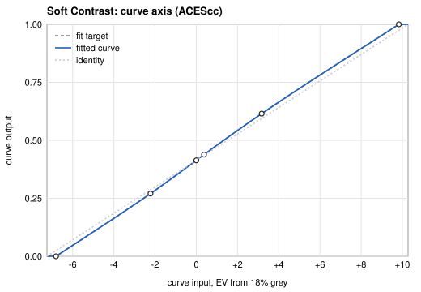 | 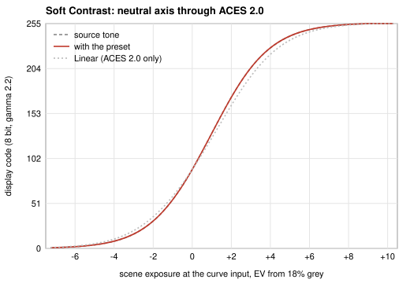 |
| Medium Contrast | 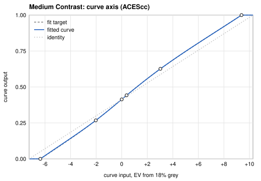 | 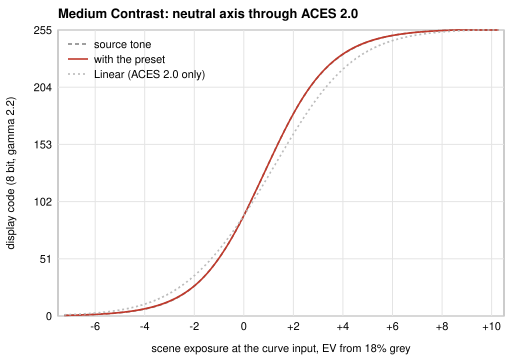 |
| Strong Contrast | 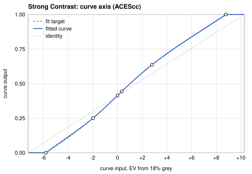 | 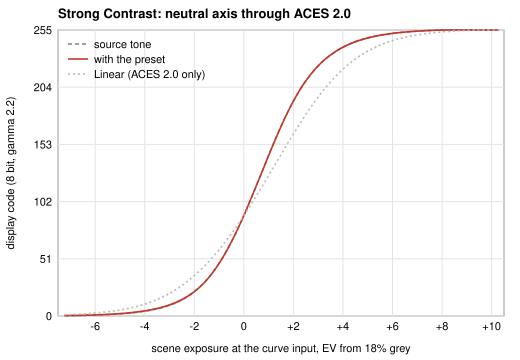 |
| Film-like | 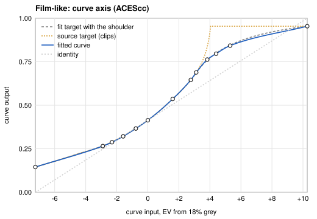 | 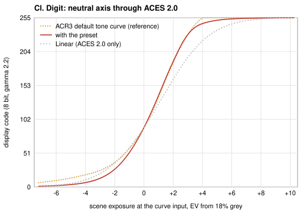 |
| Filmic | 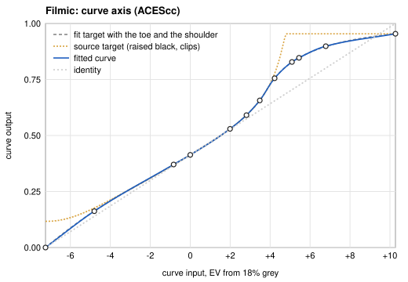 | 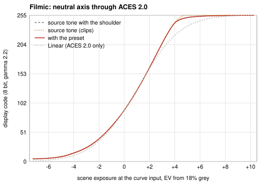 |
| Kodak 2383 |  | 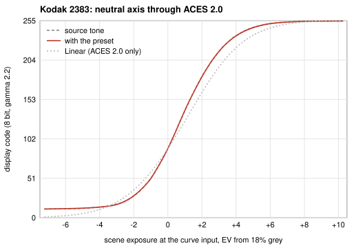 |
| Velvia 50 | 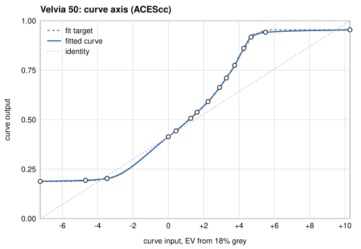 | 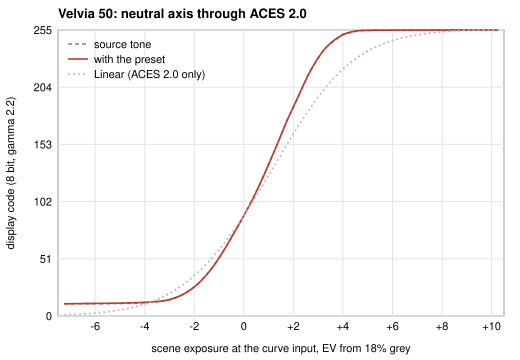 |
| Ektachrome E100 | 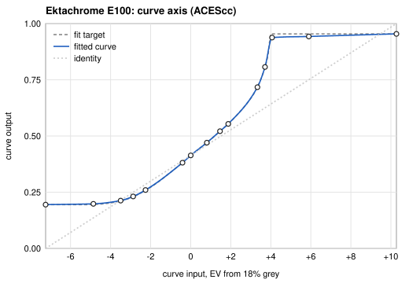 | 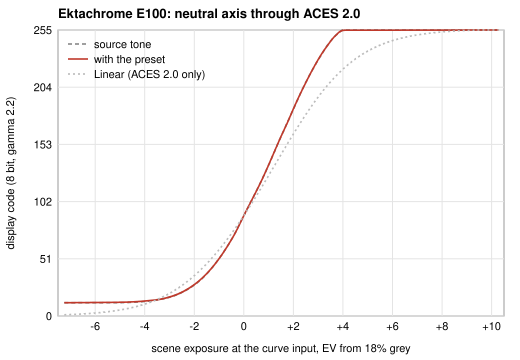 |

Observations:

- Film-like lifts the shadows over the toe of ACES 2.0 (the curve starts at y = 0.145) and
  reaches the display peak at raw white (+3.97 EV at the curve input of the Default document),
  where ACES 2.0 alone keeps 72% of the peak. Above raw white the curve is flat, as the ACR
  exposure ramp clips there.
- The three films hold a display black above 0 (the maximum density of the print or the slide):
  their curves start at y = 0.19 and stay flat over the deepest 3 stops.
- Velvia 50 and Ektachrome E100 have the steepest mid-tones and reach white about +4 EV above
  18% grey.

## 6. Film-like as the RAW import look

User decision of 2026-11-13: the default look is Film-like. `CreateDefaultPipelineDocument` sets
the RGB curve of Color Grade 1 to the points of `film_like`, with exposure +1.5 EV and saturation
1.3 as before. Contrast stays 0, because the curve carries the contrast of the look: the curve
and ACES 2.0 together give the Adobe tone at Alcedo +1.5 EV = ACR 0 EV, and contrast +15 on top
would add a second S. Documents imported before keep their stored values (contrast 15, the
identity curve), and their bytes and root ids stay the same.

The entry resets of the import look (dcp_profile_tone_curve_study.md, section 6.5) follow:

- A profile tone entry writes the identity RGB curve while the RGB curve still has the Film-like
  points: the `ProfileToneCurve` of the camera profile replaces the Adobe default curve, as in
  ACR. Contrast 15 of an older document still resets to 0.
- A Film Print entry writes the identity RGB curve while it still has the Film-like points: the
  negative and the print give the tone of that display transform, and Film-like is defined on
  ACES 2.0.

## 7. Parameters

| Symbol | Meaning | Unit | Value | Source |
| --- | --- | --- | --- | --- |
| `g` | 18% grey on the curve axis | ACEScc | 0.41359 | data (ACEScc of 0.18) |
| `s` | One stop on the curve axis | ACEScc | 0.0571 | data (1 / 17.52) |
| `N` | Neutral response of ACES 2.0 SDR | display light | `N(0.18) = 0.100` | data (product) |
| ACR anchor | Alcedo exposure of ACR 0 EV | EV | +1.5 | data (DCP study 3.3) |
| `k` | Slope of a contrast shape at 18% grey | | 1.15, 1.3, 1.5 | creative |
| `A` | Width of a contrast shape | stops | 3 | creative |
| `e_g` | Grey exposure of a source | EV | section 5 | fit |
| Spacing | Smallest x step between fitted points | ACEScc | 0.02 | creative |
| Goal | Error at which the fit stops adding points | display codes | 0.5 | creative |
| Points | Largest number of points of a preset | | 16 | data (TC1 limit) |
| Allowance | Test allowance over the fit error | display codes | 0.05 | inferred |
| Filmic parameters | Defaults of filmic rgb | | section 3.2 | data (darktable) |
| Film resources | Film print resources | | schema 11 | data (alcedo-film-lab) |
